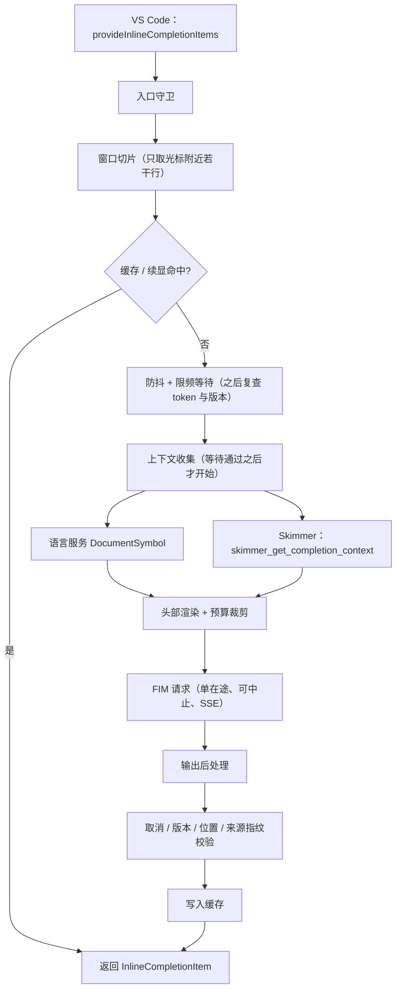

# FIM 行内补全扩展：可执行技术方案

版本：v1.2（2026-11-11）；v1.1 评审去向见 1.5；v1.2 同步阶段 B 审计修复：机器级执行设置、解析 worker、占用恢复、元数据恢复、退出收尾与安全缓存清理。
上游文档：[FIM补全扩展-自研方案评审稿.md](FIM补全扩展-自研方案评审稿.md)（下称"原稿"）  
读者：负责开项目并逐步实现的开发者。本文可独立阅读，不要求先读原稿。  
状态：A～E 核心功能已实现，阶段 F 验证与发布收敛进行中。当前进度、实际执行结果和剩余项见 README 与 `docs/stage-f-validation.md`；第 1 章保留方案评审时的基线和取证结果，不代表当前仓库状态。

本文用三种标记区分信息可信度，实现时请按标记对待：

- **【已核实】** 本次对照源码或官方文档确认过的事实（核实方式见 1.2）。
- **【决定】** 本方案做出的设计决定，按此实现；要改需先同步方案负责人。
- **【待测】** 合理但未经运行验证的数值或假设，由阶段 0 或对应阶段的实测定稿。

---

## 1. 评审结论

### 1.1 总评

原稿的主干成立，可以开工：**薄扩展 + 可选 Skimmer 增强 + 复用已有语言服务**，基础补全不依赖 Skimmer，按 Vue 2 → React Hooks → Vue 3 → Node.js 推进，成本优先、原生灰字交互。

需要改的地方集中在三类：

1. **一处事实补充**：原稿对 `SKIMMER_DB` 的描述本身准确，但没有写默认路径；默认路径的事实改变了隔离设计的出发点（F1）。
2. **三处过度设计**：编辑态增量同步协议（D1）、依赖新鲜度状态机（D2）、请求调度的"意图队列"与"传输收尾"（D6）。这三块是原稿里实现量和测试量最大的部分，但都有等效且简单得多的做法。
3. **两处会直接影响体验的遗漏**：补全菜单可见时一律不出灰字（D5）、限频期间的行为未定义（D6）。

改完之后，扩展侧的输入事件处理不读取任何文本，不维护文档镜像和新鲜度状态机；Skimmer 侧新增工作从"一套同步协议 + 一个查询接口"缩到"一个自包含的查询接口 + 一个环境变量"。

简化有一条底线（v1.1 补齐）：**可以不要状态机，但不能不要"身份"**。发给模型的每一份上下文都要能在事后被证明仍然有效：窗口靠文本逐字比较，关联文件靠 mtime / size 指纹，当前文档摘要靠内容哈希。

### 1.2 本次已核实的事实

| 事实 | 结论 | 核实方式 |
| --- | --- | --- |
| DeepSeek FIM 端点 | `POST https://api.deepseek.com/beta/completions`，Beta 功能 | 官方 FIM 指南与 API 参考页 |
| 模型名 | `deepseek-flash`、`deepseek-v4-pro` 两个可选值 | 官方 API 参考页 |
| 请求与响应字段 | `prompt` 必填、`suffix` 可空、`max_tokens`、`stop`（1～16 项）、`stream`、`stream_options.include_usage`、`temperature`（默认 1）；响应读 `choices[0].text` | 同上 |
| 输出上限 | FIM 最大输出 4K tokens；**输入上限官方页未写明** | 官方 FIM 指南 |
| 流式格式 | `data: {...}` 逐行，结束于 `data: [DONE]`；`usage` 在最后一个内容块上，含 `prompt_cache_hit_tokens` / `prompt_cache_miss_tokens` | 官方 API 参考页 |
| `InlineCompletionItem` 省略 `range` | "If not set, the word at the requested position will be used"，即默认替换光标处单词 | `vscode.d.ts`（microsoft/vscode main） |
| `range` 约束 | "Must begin and end on the same line"；官方建议 "Prefer replacements over insertions" | 同上 |
| `selectedCompletionInfo` | 存在时候选必须使用相同 range 且以选中项文本开头，否则不作为预览显示；选中项变化时 Provider 会被重新调用 | 同上 |
| Skimmer 版本 | 本地 HEAD `4977ccb`，`package.json` 为 `0.8.5`，工作区干净 | 本地仓库 `git rev-parse` / `git status` |
| Skimmer 运行要求 | `engines.node >= 22`；依赖 `better-sqlite3 ^13`（原生模块）、`@modelcontextprotocol/sdk ~1.29.0` | `package.json` |
| Skimmer 入口有副作用 | `src/index.ts` 顶层即创建 `McpServer` 并 `main()` 启动 stdio，不能当库导入 | `src/index.ts` |
| 读前同步守卫 | 经 `withReadGuard` 注册的工具，查询前 `flushDirty` + `ensureFileFresh`，最长等 3000ms | `src/tools/read-guard.ts` |
| 解析是纯函数 | `parseFile(filePath, content)` 直接接收内容字符串，不依赖磁盘 | `src/parser/index.ts:50` |
| 解析在主线程同步执行 | 索引器没有使用 `worker_threads`；单文件解析期间事件循环被占用 | `src/indexer/indexer.ts` |
| 支持的扩展名 | 仅 `.vue .js .jsx .ts .tsx`，不含 `.mjs .cjs .mts .cts` | `src/constants.ts:7` |
| `SKIMMER_AUTO_INDEX` 会阻塞握手 | 自动索引在 `server.connect(transport)` **之前** await，大项目会让 MCP 初始化长时间无响应 | `src/index.ts` 的 `main()` |
| 索引后自动监听 | `skimmer_index_project` 完成后启动 chokidar 监听，去抖 300ms、最长等待 2000ms | `src/tools/index-project.ts`、`src/constants.ts:265` |
| 已有磁盘新鲜度校验 | `checkFileFreshness(db, absPath, rel)` 用一次 `stat` 比对 mtime / size / ctime 与索引记录；文件未入库时返回"不过期" | `src/utils/index-freshness.ts:13` |
| MCP SDK 客户端启动方式 | `StdioClientTransport` 内部使用 `cross-spawn` 启动子进程 | Skimmer 仓库 `node_modules` 中的 SDK 1.29.0 |
| Skimmer 每个项目只有一个数据库连接 | 全仓库仅一处 `new Database(...)` | `src/storage/database.ts:50` |
| Skimmer 已有忽略规则实现 | 嵌套 `.gitignore`、git 根到项目根之间的祖先 `.gitignore`、`.git/info/exclude`、项目根 `.skimmerignore`；基于 `ignore` 包 | `src/indexer/ignore-rules.ts` |
| SQLite 独占锁可作单写保证 | `locking_mode = EXCLUSIVE` + WAL 并立即写入后：另一进程的读、写均得到 `SQLITE_BUSY`；`kill -9` 持有者后可立即获得；两个进程同时抢占 20 轮，每轮恰好一个成功 | 本机实测：macOS arm64、better-sqlite3 13.0.3、Node 24.21.0。**Windows / Linux 未测** |

未核实、不得当作事实引用的内容：DeepSeek FIM 的输入长度上限、各 HTTP 错误码的确切语义、Vetur/Volar 对万行文件返回的符号树形状与耗时、Skimmer 解析万行文件的实际耗时。这些都排进了阶段 0。

### 1.3 对原稿的修正与调整

**F1（事实补充）Skimmer 数据库默认路径。** 原稿第二章边界 7 写的是"`SKIMMER_DB` 指定的是进程级固定数据库路径，不会按项目自动拆分"。这句话本身是对的，它讨论的就是设置了 `SKIMMER_DB` 的情况；v1.0 把它称为"事实偏差"是本文的表述错误，在此更正。原稿没有写的是默认行为。【已核实】`src/indexer/project-manager.ts` 的 `resolveDbPath` 完整逻辑：

1. 设置了 `SKIMMER_DB` → 所有项目共用这一个文件（即原稿描述的情况）。
2. 未设置（默认）→ 库放在项目内 `<项目根>/.agent/skimmer_find_symbol/.skimmer-index.db`，每个项目一个库。
3. 项目目录不可写 → 回落到 `~/.frontend-code-skimmer/databases/<md5前8位>_<路径尾部>.db`。

这条补充对设计的影响：默认配置下，Codex、Claude Code 和将来的扩展各自启动的 Skimmer 进程会打开**同一个项目内库**。扩展如果沿用默认路径，就要面对"多个进程、可能不同版本，同时写一个库"。因此扩展仍然使用自己的缓存目录（与原稿方向一致），只是目录按项目哈希而不是按窗口会话划分（D3）。

下表是设计调整，D 编号在后文引用。

| 编号 | 原稿做法 | 问题 | 本方案 |
| --- | --- | --- | --- |
| D1 | 新增 `skimmer_update_document`：增量补丁、UTF-16 偏移、ACK、`documentInstanceId`、失配重同步 | 等于在 MCP 上重造一遍 LSP 文档同步。原稿自己允许"后台整文件解析"，增量传输省下的只是本机管道上几百 KB 的拷贝，相对解析耗时可忽略，却带来最大的一块协议与一致性测试 | **自包含全文快照**：每次查询都带当前文档全文，服务端按内容哈希复用摘要。没有镜像生命周期、补丁、ACK，也没有"上次发过什么"的客户端状态。原稿的增量协议后置，等实测证明全文传输是瓶颈再做 |
| D2 | `dirty` / `pendingIndexConfirmation` 状态机，事件驱动维护所有已打开文档的新鲜度 | 状态多、边界多（保存失败、放弃修改、重开），而需要的信息在查询那一刻可以直接算出来 | **查询时现算**：扩展用 `document.isDirty` 列出未保存文件随请求发送；服务端对每个结果来源文件 `stat` 一次，与索引里的 mtime/size 比对，不一致就丢弃并标记后台重索引；通过的文件把指纹带回，扩展在发送前、写缓存前、返回前各复核一次 |
| D3 | 按 `windowSessionId` 隔离缓存目录 | 窗口每次重开都是新会话 ID → 大项目每次开窗口都冷启动全量索引，旧会话目录还要另做回收 | 按**项目真实路径的哈希**命名数据库（跨重启稳定），同一项目被两个窗口打开时由 SQLite 独占锁保证单写（已实测，见 1.2） |
| D4 | 默认启动命令用 `@latest` | 扩展依赖新增的查询工具，`@latest` 漂移会造成协议不匹配；另有 Node 版本与 PATH 问题原稿未展开 | 默认固定兼容范围，启动后做能力协商；明确 Node 探测、首次下载超时与失败退避 |
| D5 | 请求带 `selectedCompletionInfo` 时一律返回空 | Vue/TS 文件里输入标识符或 `.` 后补全菜单几乎总是开着，停笔 1 秒时菜单通常仍可见，这会让相当大比例的自动触发直接没有灰字 | 阶段 A 就实现官方契约（`extend` 模式），保留 `skip` 开关 |
| D6 | 调度器维护"待执行意图"队列；取消后等待"本地传输收尾"才释放槽位，收尾失败重建传输资源 | 新调用到来时旧调用的 `CancellationToken` 会被取消，再加上返回前的版本与光标复查，就能保证"只有最新意图生效"，不需要自建队列。另外原稿没写**限频期间**该等待还是返回空 | "睡眠后复查 token 与文档版本"，不依赖 Provider 被调用的频率；限频期间**等待到期再发**而不是返回空；在途控制保留原稿的严格语义：旧请求**落定之后**才发新请求，没有超时旁路（6.4） |
| D7 | 没有独立的技术验证环节，A 阶段直接做完整内核 | 四个关键假设（模型输入上限、万行解析耗时、语言服务符号可用性、菜单契约）任何一个不成立都会改设计 | 新增**阶段 0**，2～3 天，产出数据后再定稿相关默认值 |
| D8 | "依赖新鲜度跟踪"放在 A 阶段 | A 阶段不使用任何索引数据，没有可被污染的来源 | 移到 B 阶段，且按 D2 简化 |
| D9 | 窗口上限"光标前 300 行 + 后 100 行"，未考虑服务端缓存 | 窗口起点随光标逐行移动，prompt 前缀每次都变，命不中 DeepSeek 的输入缓存 | 窗口起点按 25 行对齐，上下文头部保持确定性排序，让连续请求共享长前缀 |
| D10 | 上下文收集排在防抖之后，默认再等 500ms | v1.0 曾改为在防抖期间提前并行收集，**v1.1 撤回**：提前收集不受模型请求限频约束，用户持续输入时会反复读全文、反复解析，并与"全文工作只能在防抖之后"的硬规则冲突 | 与原稿一致：防抖与限频都通过之后才收集，默认等待上限 500ms。已评估放大到 1000ms 但未采纳：万行文件在 Skimmer 刚启动后的首次查询实测约 720–760ms，500ms 下该次补全拿不到跨文件上下文，但超时后 worker 仍在后台完成解析，之后的查询稳态约 100ms（实测 3 轮均如此）；放大会让来源卡死时每次最多多等 500ms，得不偿失。Skimmer 重启（改 `skimmer.*` 设置、断线重连）后会再冷启动一次 |

### 1.4 保留不变的决定

以下内容与原稿一致，不再展开论证：

- 第一版只做插入式 FIM；不做聊天、Agent、多文件修改、下一处编辑预测。
- 不把 Skimmer 源码复制进扩展，不在扩展里另建前端解析器，不抽公共核心包。
- 扩展不直接读写 Skimmer 的 SQLite 表。
- API Key 存 `SecretStorage`；日志不含 Key 与源码。
- 不接管 Tab / Escape，使用 VS Code 原生灰字接受与取消。
- 多光标、非空选择区不提供补全。
- 取消请求不等于服务端停止计费，统计时单列。
- 性能目标"停笔到出灰字约 2～3 秒"，不追求 300ms。

### 1.5 第二轮评审的采纳记录（v1.1）

7 项问题与 2 处纠正经逐条核对全部成立，全部采纳。

| 评审意见 | 本版处理 | 位置 |
| --- | --- | --- |
| 1（P1）入口未落实项目忽略规则 | 新增"发送许可判定"：`.gitignore` 链与 `.git/info/exclude`，未判定前按不许可处理；同一判定器用于当前文档、关联文件 | 6.1.1、7.5 |
| 2 缓存匹配过宽 | 改为完整窗口比较：后文整窗相等，前文从条目原起点行重取并要求恰为"原 prefix + 已敲入的预测"；窗口外的本文件改动由一个不读文本的条目筛选监听处理 | 6.3 |
| 3 保存清缓存挡不住旧请求回写 | 关联文件带 mtime / size 指纹，在缓存查找、发送前、写缓存与返回前复核；"已付费结果一定缓存"改为"通过有效性检查才缓存" | 6.3、6.8、8.2 |
| 4 全文快照缺重开、淘汰、重传规则 | 每次查询自带全文，服务端按内容哈希复用；删除 `lastSentVersion`、`need_text`、版本比较；恢复"关闭后重开"的测试 | 7.5、8.2、8.3、11.3 |
| 5 括号后处理破坏合法代码 | 删除括号计数规则。同类问题一并处理：行尾重叠规则加长度门槛，单个闭合符不再触发 | 6.6 |
| 6 提前收集上下文没有限频 | 撤回 D10，收集放回防抖与限频之后 | 6.4 |
| 7 锁文件失效回收有竞态 | 不用锁文件，改由实际写库的 Skimmer 进程持有 SQLite 独占锁，进程退出时由操作系统释放，无回收逻辑 | 7.5、8.1、8.3 |
| 纠正：F1 不是原稿的事实错误 | 改为"事实补充"，并注明 v1.0 表述有误 | 1.3 |
| 纠正：D6 对调用频率与取消的描述太绝对 | 正确性不再依赖"每次按键必然调用"；明确"落定"的定义，严格单在途，删除 300ms 旁路 | 6.4 |

有两处处理比评审建议多走了一步，实现时请留意：问题 2 的监听覆盖了评审样例之外的"窗口外改动"；问题 7 用 SQLite 自身的锁代替了"换一个可靠的锁库"，依据是 1.2 的实测。

---

## 2. 范围与术语

| 术语 | 含义 |
| --- | --- |
| 基础模式 | 只用当前文件的光标前后文本（加语言服务符号）请求 FIM |
| 增强模式 | 基础模式之上，附带 Skimmer 返回的本组件成员与关联组件接口 |
| 窗口 | 发给模型的 `prefix`（光标前）与 `suffix`（光标后）文本片段 |
| 头部 | 拼在 `prefix` 最前面的一小段注释，承载窗口之外的上下文 |
| 续显 | 用户继续敲的字符与已有预测一致时，直接返回预测的剩余部分，不再请求模型 |
| 自动触发 / 手动触发 | `InlineCompletionTriggerKind.Automatic` / `Invoke`（内置命令 `editor.action.inlineSuggest.trigger`） |

涉及两个仓库：

| 仓库 | 改动 | 阶段 |
| --- | --- | --- |
| `add-next-code`（本仓库） | 新建 VS Code 扩展 | 0、A～F |
| `frontend-code-skimmer` | 新增 1 个环境变量（含该模式下的独占打开）、1 个工具、1 组测试；E 阶段补扩展名 | B、E |

命名取自仓库名：扩展 `name` 为 `add-next-code`，配置与命令前缀为 `addNextCode`。若要改名，开工前统一替换，之后不再变。

---

## 3. 总体架构



四条贯穿全局的硬规则【决定】：

1. **防抖之前只允许 O(窗口) 的操作**（取光标附近文本、查缓存）。任何 O(全文) 的操作（`document.getText()` 全量、SFC 区块扫描、向 Skimmer 发全文）只能发生在防抖通过之后。
2. **输入事件处理不读取任何文档文本**。`onDidChangeTextDocument` 里只允许做 6.3 的缓存条目筛选（工作量以条目数为上限，每文档最多 8 条）；不复制、不解析、不哈希、不同步。"是否过期"的判断在返回前用 `document.version` 与文本比较完成。
3. **任何增强来源失败都只影响本次的头部内容**，不得阻断、延后或重试 FIM 请求本身。
4. **未通过发送许可判定的文档，任何内容都不离开本机**：不发模型，不发 Skimmer（6.1.1）。

---

## 4. 工程搭建

### 4.1 目录结构

`core/` 下的模块**禁止 `import 'vscode'`**，全部是可用 vitest 直接测的纯逻辑；`vscode/` 下是薄适配层。

```
add-next-code/
├─ package.json
├─ tsconfig.json
├─ esbuild.mjs                 # 打包为 dist/extension.js（cjs，external: vscode）
├─ .vscodeignore
├─ src/
│  ├─ extension.ts             # activate / deactivate，装配依赖
│  ├─ vscode/
│  │  ├─ provider.ts           # InlineCompletionItemProvider：守卫与总装
│  │  ├─ config.ts             # 设置 → Config 快照；配置变化时 configEpoch++
│  │  ├─ secrets.ts            # API Key 读写
│  │  ├─ status.ts             # 状态栏 + OutputChannel
│  │  ├─ docWindow.ts          # 从 TextDocument 按行取文本，喂给 core/window
│  │  ├─ symbols.ts            # DocumentSymbol 获取与缓存
│  │  └─ workspace.ts          # 最近 package.json、发送许可判定的文件读取与缓存、dirty 文件列表
│  └─ core/
│     ├─ types.ts
│     ├─ window.ts             # 预算、对齐、长行处理
│     ├─ sfc.ts                # .vue 顶层区块定位
│     ├─ framework.ts          # 框架识别
│     ├─ identifiers.ts        # 光标附近标识符与进行中的标签名
│     ├─ header.ts             # 头部渲染（注释风格、排序、裁剪）
│     ├─ ignore.ts             # 忽略规则匹配（依赖 ignore 包）
│     ├─ deps.ts               # 来源依赖指纹复核
│     ├─ cache.ts              # 补全缓存与续显
│     ├─ scheduler.ts          # 单在途、合并、超时、退避
│     ├─ postprocess.ts        # 输出过滤
│     ├─ metrics.ts            # 计数与耗时
│     ├─ fim/
│     │  ├─ client.ts          # FimClient 接口 + DeepSeek 实现
│     │  ├─ sse.ts             # SSE 行解析
│     │  └─ errors.ts          # 错误分类
│     └─ skimmer/
│        ├─ client.ts          # MCP stdio 客户端与进程生命周期（阶段 B）
│        └─ protocol.ts        # 请求 / 响应类型
├─ test/
│  ├─ unit/                    # vitest，对应 core/ 各模块
│  ├─ integration/             # @vscode/test-cli + @vscode/test-electron
│  └─ fixtures/                # 样本文件（含万行合成样本）
└─ tools/
   ├─ fake-fim-server.mjs      # 可控延迟 / 顺序 / 错误码的假模型服务
   └─ fim-smoke.mjs            # 真实接口连通与测量脚本（阶段 0）
```

### 4.2 依赖

| 类型 | 包 | 说明 |
| --- | --- | --- |
| 运行时 | `@modelcontextprotocol/sdk` | **仅阶段 B 引入**，只用 `client/index.js` 与 `client/stdio.js`，由 esbuild 打进 bundle |
| 运行时 | `ignore` | 阶段 A 引入，纯 JS、无依赖；解析 `.gitignore` 语法，与 Skimmer 用的是同一个包 |
| 运行时 | 无其他 | HTTP 用扩展宿主自带的全局 `fetch`；不引入 axios、tokenizer、解析器 |
| 开发 | `typescript`、`esbuild`、`vitest`、`@types/vscode`、`@vscode/test-cli`、`@vscode/test-electron`、`@vscode/vsce` | |

若阶段 F 测得 MCP SDK 让 bundle 体积不可接受，可在 `core/skimmer/client.ts` 接口不变的前提下换成手写的最小 JSON-RPC stdio 客户端（只需 `initialize`、`tools/list`、`tools/call`、`notifications/cancelled`）。这是备选，不是第一步。

### 4.3 `package.json` 要点

```jsonc
{
  "name": "add-next-code",
  "main": "./dist/extension.js",
  "engines": { "vscode": "^1.90.0" },          // 【待测】阶段 0 用该版本实际跑通后定稿
  "extensionKind": ["workspace"],                // 远程开发时跑在文件所在一侧，Skimmer 才能读到项目
  "activationEvents": ["onStartupFinished"],
  "capabilities": {
    "virtualWorkspaces": false,
    "untrustedWorkspaces": { "supported": false } // 不受信任的工作区不发送代码
  },
  "contributes": { "configuration": { /* 见第 5 章 */ }, "commands": [ /* 见第 5 章 */ ] }
}
```

`activate` 内只做：读配置、注册 Provider、创建状态栏项、注册命令。**不**在激活时启动 Skimmer、不读任何文件。

提醒：本仓库 `.gitignore` 目前忽略了 `.vscode`，扩展调试用的 `launch.json` / `tasks.json` 不会入库。是否放开由仓库负责人决定，实现者不要自行改 `.gitignore`。

---

## 5. 配置、命令与状态栏

### 5.1 配置项

所有数值默认值都是【待测】的起点，阶段 0 / A 实测后可调，但**键名和语义按此定稿**。

| 键 | 类型 | 默认值 | 说明 |
| --- | --- | --- | --- |
| `addNextCode.enable` | object | `{"*": true, "plaintext": false, "markdown": false, "scminput": false}` | 按 languageId 开关，`*` 为兜底 |
| `addNextCode.endpoint` | string | `https://api.deepseek.com/beta/completions` | 完整 URL，原样 POST |
| `addNextCode.model` | string | `deepseek-flash` | |
| `addNextCode.trigger.mode` | `auto` / `manual` | `auto` | `manual` 时自动触发一律返回空 |
| `addNextCode.trigger.debounceMs` | number | `1000` | 允许 300～5000 |
| `addNextCode.trigger.minIntervalMs` | number | `3000` | 同一文档两次**自动**模型请求的最小发送间隔 |
| `addNextCode.request.maxTokens` | number | `96` | 自动触发的输出上限 |
| `addNextCode.request.maxTokensManual` | number | `192` | 手动触发的输出上限 |
| `addNextCode.request.maxLines` | number | `12` | 客户端截断行数，达到即中止流 |
| `addNextCode.request.temperature` | number | `0.2` | 官方默认是 1，补全场景取低值 |
| `addNextCode.request.timeoutMs` | number | `8000` | 从发送起计的总超时 |
| `addNextCode.context.prefixChars` | number | `6000` | 光标前字符预算 |
| `addNextCode.context.suffixChars` | number | `1500` | 光标后字符预算 |
| `addNextCode.context.headerChars` | number | `2000` | 头部字符预算 |
| `addNextCode.context.maxPrefixLines` | number | `300` | 行数上限 |
| `addNextCode.context.maxSuffixLines` | number | `100` | 行数上限 |
| `addNextCode.context.extraWaitMs` | number | `500` | 防抖与限频通过之后，等待上下文的上限；语言服务与 Skimmer 共用这一个截止时间 |
| `addNextCode.context.useLanguageService` | boolean | `true` | 是否调用 DocumentSymbol |
| `addNextCode.suggestWidget` | `extend` / `skip` | `extend` | 补全菜单可见时的行为（D5） |
| `addNextCode.exclude` | string[] | `["**/.env*", "**/*.pem", "**/*.key", "**/node_modules/**", "**/dist/**"]` | 命中则不补全、不发送 |
| `addNextCode.respectGitignore` | boolean | `true` | 被项目忽略规则匹配的文件不补全、不发送（6.1.1） |
| `addNextCode.skimmer.enabled` | boolean | `false` | 阶段 F 根据实测决定是否改默认 |
| `addNextCode.skimmer.command` | string | `npx` | |
| `addNextCode.skimmer.args` | string[] | `["-y", "@jokeran/frontend-code-skimmer@^0.9.0"]` | 版本号以实际发布含新工具的版本为准，见 8.4 |
| `addNextCode.debug.dumpPrompts` | boolean | `false` | 仅调参用：把 prompt 写到本地 OutputChannel |

预算用**字符**而不是 token 计量：扩展不带 tokenizer。默认合计约 9500 字符，按代码 3～4 字符 / token 估算落在原稿建议的 2K～4K tokens 区间；实际 token 数从响应的 `usage` 回读并记录。

### 5.2 命令

| 命令 ID | 作用 |
| --- | --- |
| `addNextCode.setApiKey` | 输入框（`password: true`）写入 SecretStorage |
| `addNextCode.clearApiKey` | 删除 Key |
| `addNextCode.toggle` | 全局开关 |
| `addNextCode.showLog` | 打开 OutputChannel |
| `addNextCode.showStats` | 输出本次会话的请求统计 |
| `addNextCode.restartSkimmer` | 重启 Skimmer 子进程（阶段 B） |

手动触发直接用内置命令 `editor.action.inlineSuggest.trigger`，不另造命令和快捷键。

### 5.3 状态栏

一个 `StatusBarItem`，点击打开日志。状态与文案：

| 状态 | 显示 | 进入条件 |
| --- | --- | --- |
| 就绪 | `FIM` | 默认 |
| 请求中 | `FIM $(sync~spin)` | 有在途模型请求 |
| 已关闭 | `FIM $(circle-slash)` | 全局关闭或当前语言被禁用 |
| 缺 Key | `FIM $(key)` | 未设置 API Key；tooltip 提示运行设置命令 |
| 退避中 | `FIM $(clock)` | 429 或连续失败退避期间 |
| 配置错误 | `FIM $(error)` | 401 / 402 / 400 / 404 / 422 |
| 增强状态（tooltip） | `Skimmer: 关闭 / 启动中 / 就绪 / 索引中 / 仅本文件(索引由另一窗口占用) / 降级(原因)` | 阶段 B |

错误类通知**每种原因每个会话只弹一次**，其余只更新状态栏。

---

## 6. 核心流程规格（阶段 A 的主体）

### 6.1 入口守卫

`provideInlineCompletionItems(document, position, context, token)` 的调用可能非常频繁（按最坏情况当作每次按键一次来设计，但不要依赖这一点），以下检查都是 O(1)，任一不满足立即 `return undefined`：

1. 全局开启，且 `enable[languageId] ?? enable['*']` 为真。
2. `document.uri.scheme` 属于 `file`、`untitled`、`vscode-remote`。
3. 文档通过**发送许可判定**（6.1.1）：未命中 `addNextCode.exclude`，且未被项目忽略规则匹配。判定结果按 URI 缓存；**尚未得出结果时按"不许可"处理**。
4. 已设置 API Key。
5. `window.activeTextEditor?.document === document`，`selections.length === 1`，选择区为空，且 `selection.active` 等于 `position`。
6. `trigger.mode === 'manual'` 时拒绝自动触发。
7. 处于"配置错误"状态时拒绝自动触发；处于退避期时自动和手动都拒绝。
8. `context.selectedCompletionInfo` 存在且 `suggestWidget === 'skip'` 时拒绝。

#### 6.1.1 发送许可判定

目的：被项目忽略的文件，任何内容都不离开本机。`core/ignore.ts` 负责匹配（基于 `ignore` 包），`vscode/workspace.ts` 负责读规则文件与缓存结果。

规则来源（`respectGitignore` 为真时）。语义与 git 一致，也与 Skimmer 的 `src/indexer/ignore-rules.ts` 对齐，可以对照它实现，但不要引用它的代码：

- 文件所在的工作区文件夹内，从文件夹根到文件所在目录逐级的 `.gitignore`。每份规则相对其所在目录生效，更深层的优先；父目录已被忽略时，不能用 `!` 取回其中的文件。
- 工作区文件夹是某个 git 仓库的子目录时，从 git 根到该文件夹之间各级祖先目录的 `.gitignore`（向上最多查 12 层）。
- git 根下的 `.git/info/exclude`。

判定流程：

1. `untitled` 文档、不属于任何工作区文件夹的文件：只应用 `exclude`。
2. 其余文件：先 `exclude`，再忽略规则；任一命中即不许可。
3. 首次判定要读规则文件，是异步的。缓存里没有结果时，守卫直接返回空并在后台完成判定，下一次调用生效。**不存在"先发了再说"的路径。**
4. 失效：`FileSystemWatcher('**/.gitignore')` 触发，或 `exclude`、`respectGitignore` 配置变化时，清空结果缓存与规则文件缓存。

同一个判定器用在三处：

- 当前文档入口（本节）。
- Skimmer 返回的关联文件：逐个判定，未通过的不进入头部（7.5）。
- 发往 Skimmer 的全文快照：只会是当前文档，已被入口覆盖。

扩展触发 Skimmer 索引时一律使用其默认的 `respect_gitignore = true`。

已知边界：用户级的全局忽略文件（git 的 `core.excludesFile`）不读取，需要排除的路径请写进 `addNextCode.exclude`。

### 6.2 窗口切片

输入：文档、光标位置、可选的 `selectedCompletionInfo`（记为 `sci`）。输出：`prefix`、`suffix`、`windowStartLine`。

**虚拟光标**【决定】：`sci` 存在时，按"用户已接受菜单选中项"来构造窗口。

- `prefix` = 文档从窗口起点到 `sci.range.start` 的文本 + `sci.text`
- `suffix` = 文档从 `sci.range.end` 开始的文本
- 不存在 `sci` 时，`prefix` 止于光标，`suffix` 始于光标

**前缀起点算法**（纯函数，放 `core/window.ts`）：

1. 从光标所在行向上逐行累加字符数，直到再加一行就超过 `prefixChars`，或行数达到 `maxPrefixLines`，得到原始起点行 `s`。
2. 对齐：`start = ceil(s / 25) * 25`；若对齐后超过光标行则取 `s`。对齐只会让窗口变小，不会超预算。
3. 起点始终落在行首。

**后缀终点**：从光标向下累加，受 `suffixChars` 与 `maxSuffixLines` 约束，终点落在行尾。

**长行保护**：光标所在行在光标前的部分若超过 `prefixChars / 2`，只保留紧邻光标的 `prefixChars / 2` 个字符（此时不对齐）；光标后的部分同理按 `suffixChars / 2` 截断。任何情况下**不得改动光标两侧紧邻的字符**。

取文本一律用带范围的 `document.getText(range)`，不要取全文。

### 6.3 缓存与续显

`core/cache.ts`，一个按最近使用排序的有界表。原则：**命中必须能证明"当时发给模型的上下文，与现在等价"**；证明不了就不命中。

条目结构：

```ts
interface CacheEntry {
  docKey: string;          // document.uri.toString()
  modelKey: string;        // `${endpoint}|${model}|${temperature}|${maxTokens}`
  windowStartLine: number; // 请求时 prefix 窗口的起点行
  anchorLine: number;      // 请求时（虚拟）光标所在行
  prefix: string;          // 请求时完整的 prefix 窗口
  suffix: string;          // 请求时完整的 suffix 窗口
  completion: string;      // 后处理之后的文本
  deps: SourceDep[];       // 头部用到的关联文件及其指纹；基础模式为 []
  createdAt: number;
}
interface SourceDep { uri: string; mtimeMs: number; size: number; }
```

**查找**。输入：`docKey`、`modelKey`、当前 `suffix` 窗口、当前（虚拟）光标所在行，以及取文本回调 `readPrefixFrom(startLine)`，它返回"从该行行首到虚拟光标"的文本，由 `vscode/docWindow.ts` 提供。对该文档最近的最多 8 条逐一判断：

1. `modelKey` 相同，未超过 TTL，光标行不小于 `entry.windowStartLine`。
2. `suffix === entry.suffix`（整窗比较，不是只比开头）。
3. `p = readPrefixFrom(entry.windowStartLine)`，要求 `p.startsWith(entry.prefix)`。
4. `typed = p.slice(entry.prefix.length)`，要求 `entry.completion.startsWith(typed)` 且 `typed.length < entry.completion.length`。
5. 返回候选 `{ entry, text: entry.completion.slice(typed.length) }`。`typed === ''` 是普通命中，否则是续显。

第 3 步用**条目自己的起点行**重新取前文，而不是拿本次新算出的窗口去比。这样普通命中与续显是同一条规则：从原起点到当前光标的文本，必须恰好等于"原 prefix + 已敲入的那部分预测"。窗口内任何更早位置的改动（声明、import、函数参数）都会让 `startsWith` 失败；窗口上方增删行会让起点行对不上，同样失败；同一文件里重复的代码片段也不会串用，因为比较的是整窗而不是一段尾巴。

候选还要通过下面的**来源依赖复核**才能返回；复核失败则删除该条目。

**窗口之外的本文件改动**。文本比较看不到窗口外的编辑，而头部里的成员名来自整个文件。为此注册一个只做条目筛选的 `onDidChangeTextDocument`：

```ts
// 不读取任何文档文本；工作量以该文档的缓存条目数为上限（8）
for (const entry of cache.entriesOf(docKey)) {
  const lo = entry.windowStartLine;
  const hi = entry.anchorLine + lineCount(entry.completion);
  if (e.contentChanges.some(c => c.range.start.line < lo || c.range.start.line > hi)) {
    cache.drop(entry);
  }
}
```

改动落在 `[lo, hi]` 之内时这里不处理，由查找时的文本比较裁决。

**来源依赖复核** `depsValid(deps)`（`core/deps.ts`；只有增强模式才有非空的 `deps`）：

- 任一 `dep.uri` 对应的文档在本窗口处于未保存状态 → 无效。
- 对每个 `dep` 做一次 `fs.promises.stat`；`mtimeMs` 或 `size` 与记录不一致，或文件已不存在 → 无效。
- `deps` 为空时直接有效，不产生任何 IO。

指纹由 Skimmer 在查询时给出（8.2）。保存、外部工具改写、切换分支都会改变 mtime 或 size，所以这里不需要保存事件监听，也不需要跟踪状态。复核发生在三个时刻：**缓存查找时、发送模型请求前、写缓存与返回灰字前**。第三次复核正是为了挡住"请求在途时依赖被保存，旧响应随后返回"这一顺序。

**写入条件**。同时满足才写缓存：后处理结果非空；`document.version` 等于发起时的版本；配置代次未变；`depsValid` 通过。不满足就丢弃，不做"先存着以后也许用得上"的缓存。请求一旦被取消，HTTP 会被中止，本来也拿不到完整结果。

限制【待测】：最多 64 条；`prefix + suffix + completion` 合计不超过 2MB；TTL 120 秒；单条 `completion` 超过 8KB 不缓存。文档关闭时删除该文档的全部条目，配置代次（`configEpoch`）变化时清空。

### 6.4 防抖、限频与在途控制

原则：不建队列、不建定时器表，用"睡眠后复查"实现。

**正确性不依赖 VS Code 以什么频率调用 Provider。** 官方文档只说明"用户停止输入时"和"显式触发时"会调用；是否每次按键都调用、旧 token 何时被取消，属于编辑器内部行为，不能当作保证。因此定义一个复查函数，**每个 `await` 之后都调用**，为假就退出：

```ts
const stillValid = () =>
  !token.isCancellationRequested &&
  document.version === snap.version &&
  config.epoch === snap.epoch &&
  sameCursor(document, position);      // 即 6.1 第 5 条
```

等待与上下文收集：

```ts
// 仅自动触发执行；手动触发跳过这段等待
const sendAt = Math.max(
  Date.now() + cfg.debounceMs,
  (lastAutoSentAt.get(docKey) ?? 0) + cfg.minIntervalMs,
);
await sleepUntil(sendAt, token);
if (!stillValid()) return;

// 防抖与限频都已通过，从这里开始才允许 O(全文) 的工作
let header = await collector.collect(input, Date.now() + cfg.extraWaitMs);
if (!stillValid()) return;
if (!(await depsValid(header.deps))) header = EMPTY_HEADER;   // 来源在收集期间变了：本次退回基础模式
if (!stillValid()) return;
```

要点：

- **限频期间是等待，不是返回空。** 返回空之后编辑器不一定再次询问，用户停笔后可能一直没有补全。
- **上下文收集排在防抖与限频之后。** 全文读取、SFC 扫描、语言服务符号、Skimmer 解析的频率因此自动受同一组限制约束：自动触发下每个文档最多每 `minIntervalMs` 一次。用户持续输入、始终没停够防抖时长时，不产生任何全文工作，也不向 Skimmer 发任何查询。
- `collector.collect` 保证最迟在截止时间返回。到期仍未完成的来源按"本次无结果"处理；它晚到的结果只进入各自的摘要缓存，供下一次使用。
- `sleepUntil` 在 token 取消时立即结束。
- `lastAutoSentAt` 在**真正发出** HTTP 请求时更新；缓存命中不更新。
- 手动触发不受防抖与最小间隔约束，上下文等待上限同样是 `extraWaitMs`，输出上限用 `maxTokensManual`。
- 第一版不做预热（在防抖期间提前收集）。若阶段 F 的数据显示上下文等待是延迟主因再评估，届时必须自带独立的限频、并发上限与"只保留最新任务"的合并。

**在途控制**（`core/scheduler.ts`）。保证的是：**本扩展持有的、尚未落定的模型请求至多一个。** "落定"指 `fetch` 及其响应流读取的 promise 已经 resolve 或 reject；调用了 `abort()` 不算落定。

```ts
interface Inflight {
  key: string;
  controller: AbortController;
  result: Promise<FimResult>;
  settled: Promise<void>;     // result 落定后 resolve，永不 reject
  waiters: number;
}
```

- 新请求的 `key`（`modelKey + prefix + suffix + 头部文本` 的哈希）与在途相同 → 不发新请求，`waiters++`，等同一个 `result`。
- 不同 → 调用 `inflight.controller.abort()`，然后 **`await inflight.settled`，落定之前不发送**。没有"等够多久就先发"的旁路。等待结束后调用方先 `stillValid()` 复查，为假直接退出。
- 每个等待方失效时 `waiters--`，减到 0 才 `abort()`。
- 超时：发送时启动 `timeoutMs` 定时器，到期 `abort()`，结果标记为 `timeout`。
- 从 `abort()` 到落定的耗时记入 `abortSettleMs` 指标。某次超过 2 秒仍未落定时记一次 `stuck` 错误，状态栏进入"退避中"；槽位照样要等它落定才释放。这是需要排查的故障信号，不是可以绕过的常态。
- **任何请求都不自动重试。**
- `abort()` 只表示本地不再等待结果，不代表服务端停止计算或计费；这类请求在统计里单列。

### 6.5 FIM 客户端

接口（`core/fim/client.ts`）：

```ts
interface FimRequest {
  prompt: string; suffix: string;
  maxTokens: number; temperature: number;
  stop?: string[]; maxLines: number;
  signal: AbortSignal;
}
interface FimResult {
  text: string;
  finishReason: 'stop' | 'length' | 'client_cut' | 'aborted' | 'timeout' | 'other';
  usage?: { prompt: number; cacheHit: number; cacheMiss: number; completion: number };
  firstByteMs?: number; totalMs: number;
}
```

DeepSeek 实现的请求【已核实字段】：

```http
POST {endpoint}
Authorization: Bearer {apiKey}
Content-Type: application/json
Accept: text/event-stream

{
  "model": "{model}",
  "prompt": "{header + prefix}",
  "suffix": "{suffix}",            // suffix 为空串时传 null
  "max_tokens": 96,
  "temperature": 0.2,
  "stream": true,
  "stream_options": { "include_usage": true },
  "stop": ["\n"]                   // 仅单行模式携带
}
```

**单行模式判定**【决定】：取光标（或虚拟光标）之后、当前行剩余文本并去掉首尾空白。若它非空，且不是只由"闭合符号"组成，则为单行模式，携带 `stop: ["\n"]`；其余为多行模式，由 `maxTokens` 与 `maxLines` 约束。闭合符号指以下 9 个字符：

```text
)  ]  }  >  '  "  `  ;  ,
```

**SSE 解析**（`core/fim/sse.ts`）要求：

- 用 `TextDecoder` 以 `{ stream: true }` 解码，避免多字节字符被分块截断。
- 按 `\n` 切行并兼容 `\r\n`；跨 chunk 的半行要缓冲。
- 忽略空行和以 `:` 开头的注释行（保活）。
- `data: [DONE]` 结束；其余 `data:` 行做 JSON 解析，累加 `choices[0].text`，记录 `finish_reason`，遇到 `usage` 即保存。
- 累计文本的换行数达到 `maxLines` → 截到第 `maxLines` 行末尾，`abort()`，`finishReason = 'client_cut'`，`usage` 记为未知。
- 响应 `Content-Type` 是 `application/json` 时（部分中转忽略 `stream`）按非流式解析 `choices[0].text`。

**错误分类**（`core/fim/errors.ts`）。状态码语义【待测】，以 DeepSeek 官方错误码文档为准，阶段 0 用假 Key、错模型名各验证一次：

| 情况 | 分类 | 处理 |
| --- | --- | --- |
| 401 / 403 | `auth` | 进入"配置错误"，停止自动触发直到 Key 变更；通知一次，附"设置 API Key"按钮 |
| 402 | `balance` | 同上，文案提示余额；5 分钟后允许再试一次 |
| 400 / 404 / 422 | `config` | 进入"配置错误"，显示响应消息前 200 字符；配置变更后恢复 |
| 429 | `rate` | 退避：5s 起，每次翻倍，上限 60s；有 `Retry-After` 则取其值。成功一次后清零 |
| 5xx、网络错误、超时 | `transient` | 连续 3 次 → 退避 30s；成功后清零 |
| 被取消 | `aborted` | 不计失败，不改状态 |

### 6.6 输出后处理

`core/postprocess.ts`，纯函数，按顺序执行，任一步判定拒绝则返回空：

1. **去模型标记**：删除形如 `<｜...｜>` 与 `<|...|>` 的控制标记；若文本以 Markdown 代码围栏（连续三个反引号）开头，删除首行，并在下一个代码围栏处截断。
2. **去尾部空白**：对结果做 `trimEnd`。不动开头的空白（缩进由模型负责，不做广泛 trim）。
3. **空结果拒绝**：全为空白则拒绝。
4. **行数截断**：超过 `maxLines` 的部分丢弃。
5. **复读前文拒绝**：结果的第一个非空行（去首尾空白后长度不少于 8）若等于 `prefix` 的最后一个非空行，拒绝。
6. **行尾重叠**：记 `rest` 为当前行光标后的文本去首尾空白。`rest` 长度不少于 6 且结果以 `rest` 结尾时，去掉这一段结尾。`rest` 不足 6 个字符（典型是单个闭合符）时不处理：在 `foo(|)` 处模型返回 `bar(x)` 是正确结果，不能因为它以 `)` 结尾就截掉。
7. **后文行重叠**：记 `next` 为 `suffix` 中当前行之后第一个非空行（去首尾空白）。`next` 长度不少于 6 且结果中第 2 行起某一行去首尾空白后等于 `next`，从该行起截断。
8. 再次判空。

规则 6、7 只处理**有明确文本证据**的重叠（一段足够长的文字原样重复）；没有证据就保留模型输出，绝不删除用户已有的后文。

**第一版不做基于括号计数的结构性裁剪。** 不做词法分析就分不清字符串、注释、模板字符串、正则里的括号：在 `console.log(|)` 处模型正确返回 `")"`，括号计数会把字符串里的 `)` 当成多余闭合符，截成一个孤立的引号。由此可能残留的重复闭合符，先在阶段 A 用真实样本统计出现率，再决定是否引入有词法依据的处理。

每条规则都要有命中与不命中的单测样本，其中必须包含上面两个反例。

**2026-11-11 升级批次一（决策变更）：** 在未做出现率统计的情况下，按使用反馈（空行补全显得随机）引入了有词法依据的处理，实现见 `src/core/linePolicy.ts`、`src/core/postprocess.ts`：

- **括号越界**：扫描时跳过单双引号字符串、模板字符串和行注释。只有"结果整体闭合多于打开"且"后文去掉前导空白后正好以同一个闭合符开头"时，才从第一个多出的闭合符处截断。上面的 `")"` 反例仍原样保留。扫描不识别正则字面量与块注释，属已知局限。
- **缩进越界**：第 2 行起出现比光标所在行缩进更浅的非空行时，从该行截断；以闭合符开头的行（如 `} else {`）不由这条规则处理。
- **空行首行重复**：光标在空行时，规则 7 的比较从首行开始（长度门槛 8）。
- **空行分级**（`addNextCode.trigger.blankLine`，默认 `smart`）：上一非空行是注释或刚打开的代码块时允许多行；其余空行只补一条语句，在流内括号配平的行尾截断；窗口内光标之前没有内容时自动模式不请求。`strict` 下语句之间的空行自动模式也不请求。
- `temperature` 默认值由 0.2 改为 0。
- 会话统计增加采纳率、输入缓存命中率和费用估算（`src/core/pricing.ts` 内置 2026-11-11 官方价目）。

以上规则只有单元测试覆盖，尚无真实样本的误伤率数据。

**2026-11-11 升级批次二（方向调整）：** 使用方明确不追求出字速度，优先保证能找到正确的变量、方法和变量的子字段。原定的缩短防抖、在途复用、窗口粘性等提速降价项不做，改为：

- **文件内用法索引**（`src/core/usage.ts`，设置 `addNextCode.context.fileUsage`）：作为第三个上下文来源，按光标前的表达式扫描整份文件，产出一行候选名字，放在头部最后、裁剪时最后才丢。背景是语言服务来源的成员上限为 80 个且按 props → data → computed → methods 顺序填充，大组件里 methods 与 computed 进不了头部，且头部只有成员名、没有子字段。在 29 万字符、9193 行的真实 Vue 2 文件上单次扫描不足 1ms。
- 已知局限：只看当前文件；接收者是调用结果或下标时不处理；数组元素、接口返回值的字段只能来自文件里已有的用法；候选行随光标处表达式变化，会使其后的窗口部分无法命中服务端前缀缓存。
- **日志补全**：阶段、取消原因、行模式、用法索引结果、首段文本与结束标记时间、原始与展示规模、命中的后处理规则、未在文件出现过的属性名计数；被中止与超时的请求不再以 0 计入总耗时统计。

**2026-11-11 升级批次三（由真实误例驱动）：** 在 9193 行的真实 Vue 2 文件里，模型从空行整段生成时写出了文件里不存在的 `this.skulistPopList`，而正确的 `resResult.skuListPop` 就在同一文件的模板里，只是在提示词窗口之外。

- **同文件相关片段**（`src/core/snippets.ts`，设置 `addNextCode.context.fileSnippets`）：第四个上下文来源。检索词取自光标前 10 行、后 3 行的标识符，紧挨光标的行权重加倍；名字归一后按"相同或以检索词开头"匹配，权重与出现行数成反比，出现行数超过全文件 1%（至少 20 行）的词不用；片段以覆盖到的不同检索词计分，用过的词降权。最多 5 段、1800 字符，不含行号。`headerChars` 默认调为 4000。
- **实例成员校验**（`src/core/usage.ts` 的 `inventedMembers`、`src/core/pipeline.ts`，设置 `addNextCode.verify.members`）：草稿里有当前文件不存在的 `this` 成员或 `$refs` 名字时，以草稿为额外线索重新收集上下文；头部有变化才重发一次（同样经过单在途调度与有效性复核），采用编造更少的结果。`strict` 下从仍含编造成员的那一行起截断。这一步使一次补全最多发出两个模型请求。
- 在上述真实文件上还原到补全发生前的状态验证：首次收集的头部即包含 `<skulist-pop>` 模板片段（含 `:skuData="resResult.skuListPop"`），收集耗时约 11ms；两种编造写法均被识别，期望写法判定为干净。**尚未用真实模型验证带上片段后模型是否改选正确成员。**
- 已知局限：只检索当前文件；纯词法匹配，没有语义；mixin 里定义而本文件从未出现的成员会被误判为不存在。

**2026-11-12 升级批次四（由带原文的真实日志驱动）：** 打开 `debug.dumpCompletions` 后在同一位置观察到两类问题，均已修复并用日志里的原文回放验证：

- **编造子组件方法**：模型写出 `this.$refs.skuListPopRef?.initF(...)`、`?.setSkuList(...)`，子组件 `skulist-pop.vue` 实际只有 `open` / `close` / `submit` 等方法。原校验只检查 ref 名字，放行了这两条。现在 `inventedMembers` 增加 `$refs.ref.method` 一项：ref 指向从本项目路径 import 的组件，且"ref.method"这一对没在本文件出现过（含方括号访问）、method 也不在提示词头部里时，判为没有依据。
- **复读刚写完的代码块**：接受补全后光标停在块尾，模型连续三次把同一段注释加 `if` 块原样重写并被接受，文件里出现重复代码。原规则 5 只比较单行（且首行必须等于光标前最后一个非空行），拦不住。新增规则 5a：结果开头连续 2 行以上与光标前最后几行逐行相同（合计至少 20 字符）时拒绝。
- strict 截断后把原结果末尾的闭合行接回，避免展示未闭合的半截代码块；只剩空块时整条不展示。
**2026-11-12 升级批次五（未提交改动与意图注释）：** 使用方提出补全主要依据三样：光标上方说明意图的注释、固定写法与当前用到的变量、以及本次未提交的改动（后续代码大概率配合已改的地方），并担心一次改几十个文件时 diff 又贵又没用。

- 调研依据（直接读 Continue 开源代码 `core/autocomplete/snippets/getAllSnippets.ts` 与 `templating/filtering.ts`）：它有 git diff 来源，但目前被硬编码禁用，注释说明是 diff 通常太大、排在后面的上下文进不去；保留并优先的是"最近编辑的片段"与"最近打开的文件"，各来源限时 100ms，按总预算裁剪。
- **未提交改动来源**（`src/core/gitDiff.ts` 纯逻辑、`src/vscode/gitDiff.ts` 适配，设置 `addNextCode.context.gitDiff`）：`git diff HEAD -U2` 解析成不超过 10 行的小块，只留新代码一侧；按与光标处检索词的交集排序，当前文件的改动总是候选，其他文件必须命中一个少见的词或两个不同的词；取到 6 块 / 1600 字符为止，输出按文件与行号排成稳定顺序。其他文件经发送许可检查并带指纹进入依赖复核，有未保存修改的不用。执行 git 时不经过 shell，关闭 fsmonitor、外部 diff 与 textconv，工作区不受信任时不执行。整份 diff 超过 2MB 时退回只看当前文件。
- **意图注释权重**：紧贴光标上方的连续注释行（允许隔空行）里的标识符权重为 3，高于紧挨光标的行（2）。
- **试过并撤销**：把中文注释按相邻两个字切分参与检索。在真实文件上，"弹出""取值""如果"把无关代码排到前面，原本能取到的 `<skulist-pop>` 模板片段被挤掉，撤销后恢复。
- 头部顺序调整为：成员 → 未提交改动 → 关联接口 → 同文件相关片段 → 候选名字。越靠前的内容越稳定，利于服务端前缀缓存。`headerChars` 默认调为 5000。
- 在真实项目（4 个文件、44 个小块的未提交改动）上回放：选中 6 块，其中 2 块来自测试文件且包含 `resResult.skuListPop` 的用法；冷启动约 36–60ms，缓存后约 7–16ms；头部约 3100 字符。**尚未用真实模型验证。**
- 已知局限：未跟踪的新文件不在 `git diff HEAD` 里；改动块的行号来自磁盘，当前文件有未保存修改时"是否已在窗口内"的判断是近似的；没有单独记录"本次会话的逐次编辑"，只把会话内编辑过的文件作为加权。
**2026-11-12 升级批次六（同类代码整段进入提示词）：** 使用方给出该位置的最终实现（32 行）。对照仓库上一次提交发现，其中约 25 行改编自同一文件 2785–2833 行的旧实现，而当时的检索一行都没取到它：片段固定 7 行；`skuListPop`、`skuList` 在文件里太常见；两条注释共有的中文"为弹框视图字段"没有参与匹配。

- **中文长词组匹配**（`src/core/snippets.ts`）：意图注释切成 4 字片段，文件里同一段中文对上两个以上片段（即连续 5 个字相同）才算命中；每个片段权重 1.5。批次五里撤销的"相邻两个字"切分不恢复。未提交改动的排序使用同一规则。
- **整块扩展**：片段里有对上意图注释的注释行时，取这条注释和它下面的代码到空行为止；否则向上下合并间隔不超过 8 行的命中。两者都不越过缩进更浅的行与提示词窗口，单段最多 50 行 / 2200 字符，合计上限由 1800 调为 3000 字符，放不下时退回原来的 7 行。
- **权重由倒数改为对数**：`系数 × ln(1 + 总行数 / 出现行数)`。倒数会让远处一行里的少见词压过意图注释里的常见词。
- `headerChars` 默认调为 6000。
- 回放（上一次提交的文件，在该位置放回意图注释与空行）：使用最终那句注释时，旧实现整段 50 行排在第一位被取回，含 `map` 转换、清草稿与 `$set`；使用最初那句简短注释（"应该弹出 skulist-pop 弹框，取值就是 res.reason1.skuList"）时仍取不到，因为它和旧实现之间只有 `skuList` / `skuListPop` 这两个到处都是的名字相同。检索耗时约 10–13ms。**尚未用真实模型验证。**
- 未改动：单次输出上限仍是自动 96 token / 12 行、手动 192 token，32 行的实现需要分几次接受；可用 `request.maxTokens`、`request.maxLines` 调大。
**2026-11-12 升级批次七（第二个真实案例）：** 另一个 9293 行文件，意图注释为"判断如果复购只有1个可选的则直接选中他"。带原文的日志暴露四个问题，均已修复并用日志原文回放：

- **重复声明外层变量**：模型写了 `let repeatBuyOrderList_canSelect = []`，而该变量在 220 行之前的方法开头已声明、在后面两处还要用。内层的 `let` 遮蔽了外层变量，后面的代码拿到的是空数组——被采纳后是个不报错的 bug。回放发现外层声明当时其实在提示词的相关片段里，模型仍然重复声明，说明只靠检索不够。修复：`scopeDeclarations` 按缩进找出光标处可见的声明；新增来源 `scope` 把窗口外的声明原文单独列一行并写明不要重复声明；`fixRedeclare` 作为兜底把同层级的重复声明改成赋值。
- **整段复读没拦住**：光标在循环结束之后，模型把循环体 11 行又写了一遍。批次四的规则要求复读接在光标前最后一行，这次中间隔了一行 `})`。新增：整个结果逐行等于光标前 40 行内的某一段（4 行以上、60 字符以上）时拒绝。
- **行数硬截断留下半截代码块**：12 行处截断，缺 `}` 和 `})`，随后两次补全都在复读、一次才补上闭合。改为配平后再截（`cutBalanced`），硬上限两倍行数；`block` 模式的输出上限用 `maxTokensManual`。
- **不知道结果怎么被用**：期望是筛出"可选的父项"，模型收集的是"可选的子项"。光标后 7 行调用了 `repeatBuyOrderPopCheckedF(value, item)`，它的定义（读取 `resObj.children`）在 1300 行之外，没进提示词。新增 `calledDefinitions`：光标附近调用的本文件方法的定义排在相关片段最前。
- 试过并撤销：把光标后 25 行的标识符都纳入检索词。噪声把外层声明所在的片段挤掉了。
- 该案例的测试方法是删掉已有实现再补全。删掉的行在 `git diff` 的旧代码一侧，本扩展只取新代码一侧，所以不会把答案喂回去。用 `filter` 还是 `forEach` 这类写法选择无法从上下文推出，不作为目标。
**2026-11-12 升级批次八（第三个真实案例）：** 同一文件另一处，意图注释为"判断是否是挽留补偿类型的 如果是则找到8现金直赔的给他选中"，注释里没有任何英文标识符。模型写出了 `if (this.isWLBC) { …find(id === '8')… }`，缺 `|| this.urlQuery.insuranceId === this.showHouTiYanBuChangXian` 和 `else if (this.justPayMoney)` 分支。文件 5621 行有一段同构代码（同样的条件、`'8'`、`else if (this.justPayMoney)`、`'4'`），没有进入提示词。

- **行尾注释命名**：意图注释与 `isWLBC: false, // 是否是挽留补偿类型的…` 的行尾注释对上时，该行代码部分的标识符（`isWLBC`）加入检索词，权重 3。
- **固定搭档扩充**：权重 3 的标识符，在其出现位置前后 2 行内至少 3 处共现、且共现处占对方全部出现行一半以上的名字，加入检索词（权重 1.5，最多 2 个）。`showHouTiYanBuChangXian` 的 7 处出现里有 4 处紧挨 `isWLBC`，因此被加入，5621 行那段随之取回。
- **行尾注释不再触发"取下面整段"**：批次六的整段扩展只对独占一行的注释生效。修复前这里把 `isWLBC` 下面 50 行无关的 data 字段带进了提示词，头部从 3451 字符降到 1835。
- **片段取景**：原先同分时取最靠上的窗口，命中行总在片段最后一行，条件之后的代码看不到。改为命中行上 2 行、下 4 行，不越过所在代码块，`) {`、`} else {` 这类既闭合又打开的行视为延续。得分相近时离光标近的优先（按 250 行分档，最多加一成）。
- **复读规则再放宽两处**：比较前去掉注释行；两边都以闭合符开头的行算对上。对应日志里"开头多一行新注释"和"末行 `}` 对上 `} else {`"两次漏网。实质内容有一行不同仍不算复读。
- 三个真实案例的回放均未退步。**尚未用真实模型验证。**
**2026-11-12 升级批次九（试用流程与一类坏补全）：** 连续三份日志都来自旧代码：新 VSIX 已装到磁盘（文件哈希与构建一致），但序号接着上一份、且没有新字段。原因是安装同版本号的 VSIX 不会自动重载窗口。

- **构建标识**：`esbuild.mjs` 注入构建时间 `__BUILD_ID__`，启动时写入日志，会话统计标题里显示。
- **未重载提醒**（`src/core/buildWatch.ts`）：每 5 秒比较扩展主文件的修改时间，发现被替换后提示一次并提供"重载窗口"按钮；统计里同时标注。
- **块结束后缩进更深的续写**：光标在只有闭合括号的一行之后，结果另起一行且缩进更深时拒绝（规则 4c，`overindent`）。日志里两次这样的结果都是把上面的语句挪到块外重复一遍，其中一次被采纳后留下了多余代码。
**2026-11-12 升级批次十（新版首次在真实模型下运行）：** 日志首行出现构建时间，确认运行的是批次九的构建。

- 已在真实模型下确认生效：注释之后的整段生成一次给出完整的 15 行 `if / else`（输出 102 token，超过原来的 96 上限和 12 行上限，说明软截断与放宽的输出上限起了作用）；紧接着的整段复读被 `replay` 拦下；请求记录带 `scope`。
- 未达预期：模型写的是 `if (this.isWLBC) {…'8'…} else {…'4'…}`，仍缺 `|| …showHouTiYanBuChangXian` 与 `else if (this.justPayMoney)`。按当时实际的注释回放，批次八说的那段同构代码并不在提示词里——批次八的回放用的是修改前的注释。两个原因：
  1. 固定搭档全局只留 2 个名额。新注释多出的"收款方式的"对上了别的注释，它们的搭档把 `showHouTiYanBuChangXian` 挤掉了。改为每个名字各自最多 2 个。
  2. 即使搭档在检索词里，计分时声明 `isWLBC` 的那一段先被选中并把这两个词降权，用法所在的位置排不进前几段。改为给"名字与搭档同时出现的位置"单独留 2 个名额，离光标近的优先，取景多带 5 行后文，排在最前。
- 另修：字符串字面量里的相同中文被当成"行尾注释对上"，`refs`、`selectBank` 被误当作意图里的名字。改为只认注释部分；`refs`、`emit`、`store` 等框架通用入口加入停用词。片段上限由 5 调为 6。
- 按实际注释回放：提示词里出现 `isWLBC || …showHouTiYanBuChangXian → '8'`、`else if (this.justPayMoney) → '4'` 整段。前两个案例未退步。**这一处修复尚未用真实模型验证。**
- 已知不足：`justPayMoney` 的注释是"页面只有一个收款方式"，与意图里的"只有收款方式"只有 4 个字连续相同，按现有规则对不上；它是靠 5621 行那段用法间接带出来的。
**2026-11-12 升级批次十一（检索到位后，模型没有采用）：** 批次十的构建在真实模型下运行，参照代码（`isWLBC || …showHouTiYanBuChangXian → '8'`、`else if (this.justPayMoney) → '4'`）经回放确认位于提示词相关片段的最前面。

- `deepseek-flash`：仍写 `if (this.isWLBC) {…}`，把"选 4"嵌在里面；没有采用参照。
- `deepseek-v4-pro`（使用方在设置里切换）：同一位置写成 `item.value === '现金赔付'`，离期望更远；单次未命中费用约为 flash 的 5 倍。一次样本，不足以下定论，但没有显示出优势。
- 结论：检索环节已能把正确的参照送到模型面前；模型主要依据光标正上方那句注释的字面意思。意图注释里没写的条件（另一个险种、`justPayMoney`），放在提示词顶部的参照不足以让它补出来。
- **实验开关**（`src/core/nearCursor.ts`，设置 `addNextCode.experimental.referenceNearCursor`，默认关闭）：把 `pattern`、`anchor` 两类片段从头部移到光标上方的意图注释之前。片段来源为此给每段标注了种类（`definition / pattern / anchor / scored`）。只改请求里的前文；本地缓存键、后处理、成员校验仍用真实前文。**效果完全未验证**，需使用方对比。
- **括号规则误伤**（真实日志）：模型上一段少写一个 `}`，下一次补全以 `}`（缩进 12）开头把它补上，后文恰好以另一层的 `}`（缩进 10）开头，规则 4b 把整条删掉。改为：后文的闭合符在另一行时，只有缩进相同的才算重复。
- 未重载提醒在真实使用中触发并起作用。
**2026-11-12 升级批次十二（参照被抄成注释）：** 使用方日志里 `seq 15` 的补全整段带 `//` 前缀。逐行比对：`//` 后的空格数与头部参照块渲染出的格式完全一致（代码行在头部是 `// ` 加相对缩进，故为 `//   this.currentServiceType…`），内容是把参照里的 `else if (this.justPayMoney) → '4'` 结构改写成当前变量名——参照这次真的被用上了，只是连同 `// ` 前缀一起抄了出来。

- 后处理规则 3b（`uncomment`，`unwrapCommentedBlock`）：首行以 `{ ( [ =>` 结尾、其后至少 3 个非空行全部是 `//` 注释、去掉前缀后括号配平时还原为代码；用日志原文回放，缩进正确。反向验证：关掉该规则测试失败。
- 此前一次采纳已把注释化的代码留在文件里，需要使用方手动取消注释。
- 根因（头部参照块用 `// ` 包裹）未改：参照需要保持注释以免被当成文件内容，改格式的利弊尚无依据。
**2026-11-12 升级批次十三（缓存与成本）：** 使用方给出的累计日志里，输入缓存命中率从最初的 77% 逐步降到 19%–46%，单次请求费用从约 0.0001 美元升到 0.0004–0.0008 美元。

- 根因：提示词 = 头部 + 窗口前缀，头部在最前面，且内容随光标位置变化（相关片段、用法示例、外层声明都按光标附近的名字检索）。服务端按前缀匹配，头部一变后面几千个 token 全部失效。在真实 9000 行文件上模拟同一函数内相隔 3–12 行的连续请求：相邻两次提示词的公共前缀只有 1%–6%。
- **头部沿用**（`pipeline.ts` 的 `headerMemo`、设置 `context.reuseHeader`，默认开）：同一段意图注释之下连续的自动补全沿用上一次收集的头部。条件与失效见 README。意图注释之外的检索词会随光标变化，所以沿用的是"围绕意图选出的参照"，随后位置更新的变量名不再影响参照选择，这是为命中缓存付出的代价。沿用时同时省掉上下文收集（真实文件约 30–60 ms）与 Skimmer 查询。
- 在真实文件上复算：头部沿用后相邻提示词的公共前缀为 97%–99%（约 2300 个 token）；窗口起点每 25 行对齐一次，跨过对齐点时降到约 35%。该数字是字符级前缀，实际命中还受服务端 128 token 粒度与"尽力而为"的缓存影响，**真实命中率需要使用方的日志确认**。
- 关联接口去重：同一组件以标签名与导入名各列一次的情形，只留第一个。
- 调研结论（未实施）：
  - Skimmer 在使用方真实项目上可用：握手约 3 秒，索引（196 个源文件）约 2 秒，服务端查询 4–11 ms；返回本文件 70 个成员与子组件的 `props`。使用方当前没有开启 `skimmer.enabled`，跨文件联动实际未在工作。
  - Vue 子组件的接口只含 `props / emits / expose`，不含 `methods`。`this.$refs.xxx.method()` 是 Vue 2 里最常见的跨文件耦合，也正是早先编造 `initF`、`setSkuList` 的那一类；校验目前只能依据本文件里是否出现过。需要在 Skimmer 里为 Vue 组件接口增加公开的 `methods`（公共 npm 包，需要升版发布，未做）。
**2026-11-12 升级批次十四（第四个真实案例与 Skimmer 开启后的数据）：** 另一处：`if (/* 商家险并且是分段履约 */ this._isSegment && res.reason1?.value) {` 的函数体。期望是 `updateUploadImageListByServiceType(...)` → `materialStatus` → `getIdCardAndFaPiaoPopF(...)`；文件里 1908 行与 4922 行有同一套写法。

- 回放检索（两种光标状态）：这三个名字在光标附近一个都没有出现，检索词里只有 `_isSegment`（全文件 8 处）、`reason1`、`value`，头部不含这套写法。意图在 `if` 行内的 `/* … */`，该中文全文件仅此一处，没有可匹配的对应文字。纯文字检索对这类"名字与意图在文字上毫无交集"的情况没有抓手。**未改检索**，没有可验证的收益。
- 模型把光标之后约 20 行处已有的 `this.setFirstAndSecondReasonF(...)` 原样抄了上来并被采纳。新增规则 7a（`suffixEcho`）：结果里一行（≥ 40 字符、非注释）与光标后 80 行内某行逐字相同则从该行截断，首行就是则拒绝。
- 该构建尚无"头部沿用"（记录里没有 `hdr` 字段），日志里的缓存命中率 31% 仍是旧行为。
- Skimmer 开启后的数据（6 次查询全部成功，客户端平均 69 ms、p95 189 ms，服务端 p50/p95 38/185 ms；摘要状态 stale 5 次、failed 1 次、ready 0 次；索引 ready 5 次；成员合计 487、关联项 0）：此位置在脚本里，没有组件绑定，Skimmer 没有给出任何跨文件信息；摘要因当前文本每次都是写到一半的代码而一直不是 ready，成员来自上一份摘要。表现为头部由 3920 字符增至 4732–5434 字符，没有看到准确性收益。其价值应主要在模板里使用子组件的位置，尚未用日志验证。
- 采纳率 100%（8/8）不代表补全正确：使用方连续接受后再整体修改。统计里的采纳率只能反映"没有被立刻拒绝"。
**2026-11-12 升级批次十五（头部沿用扩展到代码块内）：** 使用方装上批次十三的构建后，日志里 `hdr` 全是 `fresh`：使用方在代码块里逐行往下写，没有意图注释，批次十三只对有意图注释的情形生效。缓存命中仅 256–768 个 token（约 10%–20%），单次约 0.0004 美元。

- **代码块锚点**（`src/core/blockAnchor.ts`，`reuseHeader = 'block'`，现为默认）：按缩进找出包着光标的块开头行（以 `{ ( [ =>` 结尾、至少 12 字符），第一次收集时记下最内层的；之后只要它仍然包着光标（也可以在它里面的嵌套块里）就沿用，写完块回到外面则重新收集。设置由布尔改为 `block / intent / off`。
- **修一个我自己引入的缺陷**：批次十三沿用头部时，头部末尾的"候选名字"行（`this.` 之后的成员候选、半个标识符的候选）会被一起沿用，而它只对收集时的光标位置有效。现在光标前要补候选名字时一律重新收集，带候选行的收集结果也不记入。
- **后文回声截断后的残句**：日志里 `seq 5` 截断后留下 `this.serviceTypeItems = [` 被展示。新增规则 7b（`fragment`）：按后文截断后括号没配平、且不以 `{` 结尾的残句整条拒绝；以 `{` 结尾的块开头仍可单独展示（`seq 3` 的 `if (…) {`）。
- 在真实文件上按日志里的写法逐行往下写 24 步复算（不调用模型）：`off` / `intent` 相邻提示词平均公共前缀 26%，`block` 为 96%。**这是字符级前缀，真实命中率需要使用方日志确认。**
- 该位置（`updateUploadImageListByServiceType → materialStatus → getIdCardAndFaPiaoPopF`）在使用方键入 `materialStatus` 之后，`seq 9` 写出了 `getIdCardAndFaPiaoPopF(materialStatus.haveIdentityCardPng, materialStatus.haveDialogInvoicePng)`，与期望一致；此前光标附近没有这些名字，检索无从下手。
**2026-11-12 升级批次十六（负缓存）：** 使用方累计日志验证了头部沿用（输入缓存命中率 31% → 67%，平均单次费用约降 60%）。同一份日志里 `seq 1 / 2 / 3 / 6` 是同一位置的四次请求，模型每次给出同一行并被 `suffixEcho` 整条拒绝，四次合计约 0.00033 美元，占该段总费用的 27%。

- **负缓存**（`pipeline.ts` 的 `rejected`）：自动触发且 `temperature` 为 0 时，请求完整返回却被后处理整条拒绝的结果，以请求键（模型、实际发出的前缀、后文、头部、是否手动）记下，两分钟内同样的键不再发请求，直接返回空；上限 64 条，`invalidate`、关闭文档时清掉。手动触发、温度不为 0、出错、被取消、超时的请求不记也不拦。
- 键里包含头部与前缀，所以任何一项变化（光标前多敲一个字、头部重新收集、配置变化）都是新请求，不会错拦。
- 日志 `neg`：`stored` 记下，`hit` 拦截；统计里显示拦截次数。
**2026-11-12 升级批次十七（后半段乱补全）：** 使用方装上负缓存的构建后反馈"后面就开始乱补全了"。日志里模型在 7948 行之后反复写出一整块 `this.mdF2({ key: …'|mdError2', value: { anTitle: '…身份证…强制露出', … } })`，经核对是**整块照抄**窗口开头附近（离光标约 170 行）7776–7786 行已有的代码；而批次四的复读规则只比较光标前最近 40 行，漏掉了。

- 规则 5b（`clone`）：结果的代码行（去掉注释与空行）里，若有一段连续 >= 6 行、合计 >= 120 字符，与光标之前窗口里的一段连续代码行逐行相同，且占结果代码行的 60% 以上，整条拒绝。用日志原文回放被拦住；`seq 13`（单行 `SC1notUpload: …`）、`seq 19`（单行 `$toastMd(…)`）等单行不受影响。样本区分度：被抄的块连续相同 11 行、覆盖 73%；此前几个真实案例的好补全最多连续相同 3 行、覆盖 20%。反向验证：关掉规则或把阈值放宽到 3 行，测试失败。
- 负缓存**一次都没拦下**：`seq 8 / 9`、`26 / 27 / 28` 的前缀完全相同，后文的字符数每次多 1（1485 → 1486、1487 → 1488 → 1489），键不同。键改为对"光标行之前的部分"与"光标之后每一行"忽略行尾空白，其余任何变化仍是新请求。**后文每次多出的那个字符是否就是空白，只是推断，需要下一份日志确认（`neg: hit` 是否出现）。**
- 其余观察：位置越过了真实实现的末尾后（真实代码到 `const haveIdentityCardPng = …` 就结束，后面是 `} else {`），上下文里没有任何信息能说明"该停了"，模型只能继续编；这不是检索或后处理能根治的。可能的杠杆是用 `logprobs` 给每个补全打置信度、低的不展示：接口文档允许 `logprobs` 与 `suffix` 同用，但流式响应的字段形状与取值没有在真实接口上验证过，未实施。
- 仍未解决：模型在该位置没有主动写出 `this.resResult.skuListPop = ...`（期望写法）。提示词里已有模板片段，但 2832 行的同类写法 `this.$set(this.resResult, 'skuListPop', skuList)` 未被检索到；开启 Skimmer 后头部会带上子组件的 props，是否足以引导模型尚未验证。

### 6.7 返回项与 `selectedCompletionInfo` 契约

| 情况 | `range` | `insertText` |
| --- | --- | --- |
| 无 `sci` | `new Range(position, position)`（**必须显式传**，省略会替换光标处单词） | 后处理结果 |
| 有 `sci`，`extend` 模式 | `sci.range` | `sci.text + 后处理结果` |

`extend` 模式下后处理结果为空则返回空，不返回只含 `sci.text` 的候选。菜单选中项变化时 VS Code 会重新调用 Provider 并取消旧 token，走正常的防抖与限频，不需要读取任何编辑器内部状态。

自动触发返回 1 个候选即可；手动触发第一版同样只返回 1 个（不做多候选轮换）。

### 6.8 总装伪代码

```ts
async provideInlineCompletionItems(document, position, context, token) {
  if (!guards(document, position, context)) return;             // 含 6.1.1 的发送许可
  const seq = ++this.seq;
  const snap = { version: document.version, epoch: config.epoch };
  const sci = context.selectedCompletionInfo;
  const manual = context.triggerKind === InlineCompletionTriggerKind.Invoke;
  const stillValid = () => /* 见 6.4 */;

  const win = buildWindow(document, position, sci);             // O(窗口)
  const hit = cache.lookup(docKey, modelKey, win, readPrefixFrom);
  if (hit) {
    if (await depsValid(hit.entry.deps)) {
      return stillValid() ? [toItem(hit.text, position, sci)] : undefined;
    }
    cache.drop(hit.entry);
  }

  if (!manual) {                                                // 6.4：防抖与限频
    await sleepUntil(sendAt, token);
    if (!stillValid()) return;
  }

  let header = await collector.collect(input, Date.now() + cfg.extraWaitMs);
  if (!stillValid()) return;
  if (!(await depsValid(header.deps))) header = EMPTY_HEADER;   // { text: '', deps: [] }
  if (!stillValid()) return;

  const result = await scheduler.run(buildRequest(win, header, manual), token, stillValid);
  const text = postprocess(result.text, win);
  metrics.record(seq, ...);

  if (!text || !stillValid()) return;
  if (!(await depsValid(header.deps)) || !stillValid()) return; // 在途期间来源变了：不显示、不缓存
  cache.put({ ...win, completion: text, deps: header.deps });
  return [toItem(text, position, sci)];
}
```

---

## 7. 上下文增强

### 7.1 SFC 区块与框架识别

**SFC 区块定位**（`core/sfc.ts`）：对 `.vue` 全文按行扫描顶层 `<template>`、`<script>`、`<style>` 的起止行，`<template>` 内部对嵌套的 `<template` / `</template>` 计数。结果按"URI + version"缓存，**只在防抖通过后**计算。用途：决定头部注释风格、把"光标所在区域"写入指标。

**框架识别**（`core/framework.ts`），按顺序取第一个命中：

| languageId | 规则 | 结果 |
| --- | --- | --- |
| `vue` | 存在 `<script ... setup ...>` | `vue3` |
| `vue` | 最近的 `package.json` 中 `vue` 主版本为 3 / 2 | `vue3` / `vue2` |
| `vue` | 脚本中出现 `defineComponent(` 或 `setup(` | `vue3` |
| `vue` | 其余 | `vue2` |
| `javascriptreact` / `typescriptreact` | 直接判定 | `react` |
| `javascript` / `typescript` | 前 50 行有来自 `react` 的 import | `react` |
| `javascript` / `typescript` | 其余 | `node` |
| 其他 | | `generic` |

"最近的 `package.json`"从文件所在目录向上找到工作区根为止，结果按目录缓存，用 `FileSystemWatcher('**/package.json')` 失效。识别结果只影响头部的组织方式和指标标签，**不影响请求链路**。Skimmer 可用时以其返回的 `framework` 为准。

### 7.2 语言服务符号

`vscode/symbols.ts` 只使用一个命令：`vscode.executeDocumentSymbolProvider`。

- 结果按"URI + version"缓存。请求时若缓存版本落后，发起一次刷新，但**不等它超过上下文截止时间**；本次用旧缓存的**名称**（不使用任何行号）。
- 同一文档同时最多一个在途的符号请求。
- 禁止调用 `vscode.executeCompletionItemProvider` 与 `vscode.executeInlineCompletionItemProvider`（前者可能很重，后者会递归到自己）。
- Hover / Definition 第一版不用；跨文件接口交给 Skimmer。

从符号树提取的内容：

| 框架 | 提取 |
| --- | --- |
| `vue2` | 默认导出对象下 `props`、`data`、`computed`、`methods`、`watch` 的子项名称 |
| `vue3` | `<script setup>` 顶层声明名；或 `setup()` 返回对象的键名 |
| `react` | 包含光标的组件函数内的顶层声明名（state、handler、ref）。函数声明组件（SymbolKind.Function）与箭头函数组件 `const App = () => {...}` 都要识别：后者在 TS 语言服务里是 `Variable`，以"子节点含 `const`/`function`"区分，对象常量 `const Styles = {...}` 的子节点是 `property`/`method`，不算组件（已用 VS Code 内置 tsserver 的 navtree 核实） |
| `node` / `generic` | 包含光标的符号链名称，以及同级符号名称 |

Vetur / Volar 返回的树形状不保证如上【待测】。若阶段 0 发现 Vue 2 的树不可用，阶段 A 的 Vue 2 就**不带成员摘要**（只有窗口），成员摘要改由阶段 B 的 Skimmer 提供。不在扩展里写正则或解析器兜底。

### 7.3 头部格式

头部拼在 `prefix` 最前面，是一段注释。注释风格取决于**窗口起点所在区域**：`.vue` 的 `<template>` 区用 `<!-- -->`，其余用 `//`。

脚本区示例：

```js
// [context] reference only, not part of this file
// file: src/views/order/List.vue (vue2)
// members: props: id, visible; data: loading, list, query; computed: total; methods: fetchList(page), onSearch()
// <OrderTable> src/components/OrderTable.vue: props rows, loading, pageSize; emits select, page-change
// [/context]
```

模板区用同样的内容包在一对 `<!--` 与 `-->` 之间，每行不再加前缀。

渲染规则【决定】：

1. 行顺序固定：`file` → `members` → 关联项（按名称字典序）。同类成员按名称字典序。**确定性排序是为了命中服务端输入缓存**，不要按"相关度"动态换序。
2. 预算裁剪顺序：先删关联项（从列表末尾删），再删 `members` 中未出现在窗口文本里的名称，最后整段丢弃。`file` 行最后丢。
3. 头部总长不超过 `headerChars`；没有任何增强信息时头部为空串，不输出空壳。
4. 内容里不放源码片段，只放名称和签名。第一版不做"相关实现片段"。
5. 收集器合并各来源成员时，语言服务给出的通用 `scope` 成员与 Skimmer 同名的具体种类成员（`state`、`handlers`、`props` 等）只保留具体种类，避免同一个名字在头部出现两次。
6. 渲染结果是 `{ text, deps }`。`deps` 只包含**实际写进头部**的关联文件及其指纹（6.3）；被预算裁掉、被发送许可判定挡掉的关联项不计入。

头部是否会被模型续写进结果，阶段 0 用固定样本对比验证；若出现，优先调整标记文案，其次在后处理规则 1 里过滤 `[context]` 行。

### 7.4 标识符提取

`core/identifiers.ts` 从 `prefix` 的最后 20 行与当前行剩余文本提取，最多 20 个，按优先级排序：

1. 光标所在的未闭合标签名（从光标向前找最近的 `<Name`，且其后到光标之间没有 `>`）。
2. 当前行出现的标识符。
3. 其余行出现的标识符，按离光标由近到远。

匹配用 `/[A-Za-z_$][\w$-]*/g`，去重，过滤长度小于 2 的项和语言关键字。

### 7.5 Skimmer 客户端（阶段 B）

**启动时机**：`skimmer.enabled` 为真，且第一次有补全请求通过防抖时才懒启动。启动期间的请求全部走基础模式。

**进程模型**【决定】：每个 VS Code 窗口一个长期子进程，服务本窗口所有工作区文件夹。用 SDK 的 `StdioClientTransport` 启动；它内部用 `cross-spawn`【已核实】，Windows 下 `npx.cmd` 能否正常拉起仍要在阶段 F 的兼容性矩阵里实际验证。

**配置边界**：`endpoint`、`skimmer.enabled`、`skimmer.command`、`skimmer.args`、`skimmer.nodePath` 使用 `scope: "machine"`，由用户设置控制，工作区无法改写请求目的地或执行程序。只有 `skimmer.*` 变化才重启子进程；重启等待旧连接和旧启动任务关闭后，后续补全再懒启动。

**环境变量**：以 MCP SDK 的基础运行变量为起点，只额外允许临时目录、代理、证书及 npm registry/cache/proxy/cafile 变量，再设置 `SKIMMER_CACHE_DIR=<globalStorageUri>/skimmer`。不转发任意 shell 凭据、`NODE_OPTIONS` 或原有 `SKIMMER_*` 覆盖项。

**Node 探测**：启动前执行一次 `node --version`，低于 22 或找不到 → 不启动，状态栏说明原因，并提示可用 `skimmer.command` 指定绝对路径。

**握手与能力协商**：

1. `initialize`，首次启动超时 120 秒（`npx` 需要下载包与原生模块），之后 20 秒。
2. `tools/list` 必须包含 `skimmer_get_completion_context`；否则判定"版本不兼容"，关闭进程，本会话不再尝试。该工具**只在服务端设置了 `SKIMMER_CACHE_DIR` 时注册**（不影响公开 MCP 用户的工具清单），扩展启动子进程时一定设置该变量，所以握手检查不受影响；自定义 `skimmer.command` 若是包装脚本，必须把环境变量透传给 Skimmer，否则会被判为版本不兼容。
3. 记录服务端版本到日志。

**项目占用（单写保证）**：不用锁文件。Skimmer 在 `SKIMMER_CACHE_DIR` 模式下以 SQLite 独占锁打开项目库（8.1）。锁由**实际写库的 Skimmer 进程**持有，进程退出（含崩溃、被杀）时由操作系统释放，所以没有"失效锁回收"这个步骤，也就没有回收竞态。机制已在本机实测（1.2）。

- 第二个进程打开同一个库会得到 `SQLITE_BUSY`。此时查询工具返回 `index.state = 'locked'`、`related` 为空，但 `self` 照常返回（解析当前文档不需要数据库）。扩展据此进入"仅本文件"状态：头部只有本文件成员，不再对该项目发索引请求。
- 占用可能易手：Skimmer 对空闲项目有回收（默认 30 分钟关闭库），占用方回收后另一窗口可能取得占用。所以扩展对 `locked` 的处理必须是**每次查询都判断**，不能只在启动时判断一次。
- 服务端对锁失败负缓存 3 秒，独占打开的 SQLite 等待从 200ms 降为 20ms。状态为 `locked` 的项目，扩展每 5 分钟最多重试一次索引请求；收到非占用响应即取消锁退避，执行"重启 Skimmer"命令也清除退避。

这是已知限制：同一项目开两个窗口时，同一时刻只有一个窗口有跨文件增强。接受它，换来不需要多进程写库的任何协调。

**索引**：后台调用现有工具 `skimmer_index_project({ project_path })`（不 await，请求超时设 30 分钟，其余参数用默认值，即遵循 `.gitignore`）。它完成后会自行启动文件监听。索引期间查询返回 `index.state = 'indexing'`，扩展照常使用已有的部分结果。响应的可选 `index.watching` 字段报告监听状态；项目被 LRU/空闲回收后，`watching=false` 让扩展重新索引并启动 watcher，不永久沿用窗口内的已索引标记。

**查询**：工具规格见第 8 章。

- 每次查询都带当前文档全文。查询只发生在防抖与限频通过之后（6.4），所以频率有上限。扩展侧**不记录"已经发送过什么"**，服务重启、文档重开、摘要被淘汰都不需要任何恢复动作。
- 返回的 `related` 逐项经过 6.1.1 的发送许可判定，未通过的丢弃。
- 通过的项连同其 `fingerprint` 记入 `header.deps`，供 6.3 的来源依赖复核使用。

**失败处理**：

| 情况 | 处理 |
| --- | --- |
| 单次查询超过截止时间 | 发送 MCP 取消通知，本次头部不含 Skimmer 内容，不计失败 |
| 连续 5 次超时 | 暂停查询 60 秒 |
| 进程退出 / 传输错误 | 10 分钟后重启，每会话最多 3 次；期间基础模式 |
| 版本不兼容 / Node 不满足 | 本会话不再尝试 |

**退出**：扩展 `deactivate` 返回关闭 Promise。服务端监听 stdin `end/close` 和 SIGINT/SIGTERM，拒绝新工具调用，等待 worker、在途工具、watcher 收尾后释放库。

**磁盘清理**：责任下沉到实际持锁的 Skimmer。启动后延迟 60 秒执行一次，此后每 6 小时执行；候选条件是旁路元数据里的项目根已不存在，或数据库文件与 `-wal` 文件的修改时间都早于 30 天。打开与清理均使用永久 SQLite lease 协调锁，清理还必须取得实际数据库锁，并在持 lease 期间再次确认条件才删除 DB/WAL/SHM/JSON。活动库、无 lease 的旧库、符号链接及异常条目保留；lease 文件不能删除再建，否则会破坏跨进程互斥。新模式成功独占打开旧库后才将其纳入 lease 管理。

---

## 8. Skimmer 仓库改动规格（阶段 B / E）

实现者先读这几个文件再动手：`src/index.ts`、`src/tools/read-guard.ts`、`src/indexer/project-manager.ts`、`src/parser/index.ts`、`src/parser/component-binding.ts`、`src/storage/database.ts`、`src/utils/index-freshness.ts`。优先复用现有查询方法，不要为新工具新写 SQL 能解决的重复逻辑。

### 8.1 S1：`SKIMMER_CACHE_DIR`

改 `src/indexer/project-manager.ts` 的 `resolveDbPath`：

- 设置了 `SKIMMER_CACHE_DIR` → 数据库路径为 `<dir>/<sha256(真实项目根).slice(0,16)>.db`，同时写旁路文件 `<同名>.json`，内容 `{ "root": "...", "createdAt": ... }`。
- `SKIMMER_DB` 与 `SKIMMER_CACHE_DIR` 同时设置 → 构造 `ProjectManager` 时直接抛错，进程以非零码退出。
- 都未设置 → 行为完全不变。

**独占打开**（仅 `SKIMMER_CACHE_DIR` 模式；改 `src/storage/database.ts` 的构造与 `initialize`）：

1. 创建连接时把 `better-sqlite3` 的 `timeout` 设为 200ms（默认是 5000ms，探测占用不该等这么久）。
2. **先**执行 `PRAGMA locking_mode = EXCLUSIVE`，**再**执行 `PRAGMA journal_mode = WAL`。顺序不能反。
3. 随后立即执行一次写入（例如更新一行元数据）以确实取得锁。只读不写时取得的只是共享锁。
4. 上述任一步抛出 `SQLITE_BUSY` → 转为可识别的 `ProjectLockedError`，不重试、不回落到其他路径。

【已核实】当前每个项目只有一处 `new Database(...)`，进程内不存在会被自己的独占锁挡住的第二个连接。实现时若新增连接（例如给 worker 用），必须先重新评估这一条。默认模式与 `SKIMMER_DB` 模式的打开方式完全不变，现有 MCP 宿主不受影响。

### 8.2 S2：新工具 `skimmer_get_completion_context`

> **门控**：Skimmer 是对外发布的公开 MCP，这个工具只服务扩展。服务端仅当 `SKIMMER_CACHE_DIR` 非空时才注册它（与 `ProjectManager` 判定独占缓存模式用同一个条件），普通 `npx` 用户的 12 个工具与 v0.8.5 完全一致，也不会为它多付 `tools/list` 的体积（约 1.6KB）或加载补全 worker。
>
> **关闭语义**（对所有模式生效，已有回归测试）：stdin 结束时先等在途工具把响应写完再关闭传输层，默认模式一直等、扩展模式最多 5 秒；SIGINT/SIGTERM 立即收尾、不等在途工具（与 v0.8.5 一致；实测哪怕只给 0.5 秒宽限，大项目初次索引时的 SIGTERM 退出也会多出约 1.5 秒）。此前“先关传输层、再等在途工具”会让一次性管道调用丢响应，“无上限等待在途索引”会让大项目初次索引时的 SIGTERM 退出慢约 7 倍（实测 3.3s → 22.5s）。

新文件 `src/tools/completion-context.ts`，在 `src/index.ts` 里用**原始 `server`** 注册（不经过 `withReadGuard`）。现有分析工具的读前同步行为不动。

设计约束：**请求自包含**。服务端回答一次查询所需的全部信息都在这次请求里；服务端的任何缓存都只是为了省重复计算，丢了只会慢一次，不会错。

入参：

```ts
{
  protocol: 1,
  project_path: string,                       // 项目根绝对路径
  file_path: string,                          // 绝对或相对路径
  document: { text: string },                 // 必填：当前文档全文，每次查询都带
  cursor: { line: number, character: number },// 0 基；character 为 UTF-16 单位（与 VS Code 一致，JS 字符串天然如此）
  identifiers?: string[],                     // 按优先级排序，最多 20
  dirty_files?: string[],                     // 本窗口其他未保存文件的相对路径
  max_items?: number,                         // 默认 8
  budget_chars?: number,                      // 默认 2000
  deadline_ms?: number                        // 默认 400
}
```

入参里没有文档版本号、文档实例标识、"是否已发送过"之类的字段，这是有意的。

出参（同时放进 `structuredContent` 与 `content[0].text` 的 JSON 字符串）：

```ts
{
  protocol: 1,
  framework: 'vue2' | 'vue3' | 'react' | 'ts' | 'js' | 'unknown',
  overlay: { state: 'ready' | 'stale' | 'failed' },
  index:   { state: 'ready' | 'indexing' | 'empty' | 'locked' },
  self: null | {
    members: Array<{ kind: string; name: string; signature?: string }>,
    truncated: boolean
  },
  related: Array<{
    kind: 'component' | 'hook' | 'module' | 'store',
    name: string,
    file: string,                             // 相对路径
    binding: 'static' | 'heuristic',
    interface: Array<{ kind: string; name: string; signature?: string }>,
    fingerprint: { mtimeMs: number; size: number }   // 本次 stat 的结果，供扩展复核
  }>,
  dropped: Array<{ file: string; reason: 'dirty' | 'stale' | 'budget' }>,
  elapsedMs: number
}
```

`overlay.state` 描述的是**整文件成员摘要**的新旧：`ready` 表示摘要来自本次请求的文本；`stale` 表示本次文本的摘要尚未完成或解析不出来，摘要成员来自该路径上一次成功解析的结果；`failed` 表示没有可用的成功摘要，可能仍在后台解析，后续查询可恢复。位置相关的 `self`（React 当前组件、Node 当前类）不受此限：它由本次文本按光标算出，`stale` / `failed` 时也可能非空（见下文第 4 条）。`document.text` 最多 2,000,000 UTF-16 字符，扩展配置不得超过该硬上限。

服务端行为【决定】：

1. **不等待索引**。不得调用 `flushDirty`、`ensureFileFresh`、`indexProject`，不得等待任何索引任务。允许创建缓存库、标记脏文件交后台刷新，因此 MCP 注解为 `readOnlyHint=false`、`destructiveHint=false`。
2. **摘要缓存**：进程内 `Map`，键为"项目根 + 相对路径"，值为 `{ contentHash, summary }`，最多 8 个文档，按最近使用淘汰。`contentHash` 是 `document.text` 的 SHA-1。条目被淘汰、进程重启、文档关闭后重开、编辑器版本号回退，结果都只是重新解析一次。
3. **解析当前文档**：
   - `contentHash` 与缓存一致 → 直接用缓存，`overlay.state = 'ready'`。
   - 不一致 → 在 worker 排队整文件 `parseFile` 摘要，有旧摘要立即返回 `stale`，没有则最多等待 80ms 且不超过剩余 deadline。成功后更新摘要，后续同文本查询为 `ready`。摘要只决定 `self` 的新旧，**不决定 `related`**（见下条）。
   - 解析抛错或得到 0 个符号（输入中的语法不完整属于常态）→ **不覆盖缓存**。该路径有旧摘要则 `'stale'` 并用旧摘要作答；没有则 `'failed'`、`self = null`。
   - `stale` 时 `self.members` 只含名称与签名。**响应里任何地方都不返回行号**，所以旧摘要不会带来位置错位。
4. **`self`**：Vue 取组件级符号；React 取"包含光标的组件"及其内部绑定；Node 取模块顶层加光标所在的类；其余普通模块取顶层声明。**React 与 Node 的 `self` 随绑定任务一起由本次文本算出**（按行与列判断光标所在作用域），不依赖整文件摘要：扩展每次编辑后只查一次，摘要总是落后一版，而旧摘要的行号不可信，若仍依赖它，真实输入下 React/Node 的 `self` 会一直为空。正在输入的未闭合 JSX 标签（后面是兄弟标签、父级闭合标签、`)`、`;`、`}` 或文件结尾）只在光标处补一个 `/>` 再解析，同一份修复后的模块同时用于绑定与 `self`；其余无法解析的脚本，这类 `self` 为空。排序：先是出现在 `identifiers` 里的，再按名称字典序。超预算截断并置 `truncated`。
5. **`related`**：只依据**本次文本**的静态绑定，按 `identifiers` 的顺序把名称解析到目标文件，再从索引取对外接口。绑定由 worker 里独立的轻量任务解析（只做 import/export/组件注册解析，不跑整文件 `parseFile`，万行文件实测约 98ms，优先于摘要任务出队），随本次请求等待至 `deadline_ms`。旧文本的绑定不得授权新文本的关联关系；摘要 `stale` **不影响** `related`——扩展每次编辑后只查一次且每次文本都不同，若要求摘要先就绪，跨文件上下文在真实输入下几乎不会出现。本次脚本无法解析（如括号未闭合）时 `related` 为空。关联模块的 AST 也由 worker 解析并按内容 hash 有界缓存。支持经过 Vue 导入身份校验的 `Vue.extend({ components })`。达到 `max_items` 或 `budget_chars` 即停，其余记入 `dropped` 且 `reason = 'budget'`。
6. **新鲜度过滤与指纹**：
   - 目标文件在 `dirty_files` 里 → 丢弃，`reason = 'dirty'`。
   - 否则用现有的 `checkFileFreshness`（`src/utils/index-freshness.ts`）做一次 stat 比对。过期 → 丢弃，`reason = 'stale'`，并把该文件加入索引器的脏集合交给后台去抖刷新（不等待）。
   - 通过 → 把这次 `stat` 得到的 `mtimeMs` 与 `size` 写入该项的 `fingerprint`。
7. **超时与取消**：worker 的解析不阻塞 MCP 主线程；等待受 deadline 和 MCP 取消信号约束。每个关联项之间复查 deadline / 取消，取消时撤掉未开始的等待任务；已经运行的同步解析允许后台结束，但过时结果不得覆盖更新 hash。
8. 第三方裸模块（`node_modules`）不解析、不返回。
9. **项目库被占用**：打开数据库抛出 `ProjectLockedError`（8.1）→ `index.state = 'locked'`、`related = []`；第 3、4 步照常执行并返回 `self`。

**解析使用 worker**【已实施】：审计中合成约 465KB 文件改动后同步解析约 584–648ms，已超过原定 300ms 阈值。当前使用单个 `worker_threads` 解析线程，每文档只保留一个最新待处理任务，全局最多 8 份排队文本；worker 不接触数据库。当前文档与关联模块解析均离开主线程。**现有索引路径的同步解析第一版不改**；真实万行文件与非首次索引期间查询超时占比仍需在真实编辑器测量。

### 8.3 S3：测试

新文件 `tests/completion-context.test.ts`，至少覆盖：

查询行为：

- 首次查询允许后台预热，后续返回 `ready`；相同文本及查询位置不重复解析（用打点或计数断言）。
- 语法不完整的文本 → `stale` 并沿用旧成员；该路径无旧摘要 → `failed`、`self = null`。
- **重开场景**：同一路径先查文本 A，再查完全不同的文本 B → 返回 B 的成员，不残留 A 的任何名称。
- **淘汰场景**：依次查询 9 个不同文件后回到第 1 个 → 正常返回 `ready`，结果与第一次一致。
- `dirty_files` 命中的关联文件被丢弃且 `reason = 'dirty'`。
- 修改磁盘文件但不触发索引 → 该文件被丢弃且 `reason = 'stale'`。
- 通过过滤的关联项带 `fingerprint`，其值等于该文件当前的 `stat` 结果。
- 响应 JSON 中不出现任何行号字段。
- 未索引项目 → `index.state = 'empty'`，不抛错。
- 工具执行期间不触发 `flushDirty` / `ensureFileFresh` / `indexProject`（用打点断言）。

缓存目录与占用：

- `SKIMMER_CACHE_DIR` 下两个不同项目各含 `src/App.vue`，数据库文件不同、内容互不可见。
- `SKIMMER_DB` 与 `SKIMMER_CACHE_DIR` 同设时启动失败。
- **占用互斥**：进程 A 持有某项目库时，进程 B 对同一项目查询 → `index.state = 'locked'`、`related` 为空、`self` 正常。
- **崩溃释放**：强杀进程 A 后，进程 B 再次查询 → 不再是 `locked`。
- **并发抢占**：两个进程同时对同一项目发起索引，重复 20 轮，每轮恰好一个成功、另一个得到占用错误。该用例必须在 macOS、Windows、Linux 上各跑通一次（本文 1.2 的实测只覆盖 macOS）。
- 未设置 `SKIMMER_CACHE_DIR` 时，数据库的打开方式与现状一致（两个进程可以同时打开项目内库）。

回归：现有全部测试通过（`npm run check`）。

### 8.4 S4：发布

以上合入后发一个新的 minor 版本（下文以 `0.9.0` 指代，以实际发布号为准）。扩展的默认 `skimmer.args` 写成 `@^0.9.0`，并在握手时校验工具存在。之后凡是改动该工具的入参或出参，递增 `protocol`，扩展侧按 `protocol` 判断兼容。

### 8.5 S5（阶段 E）：Node.js 扩展名

把 `.mjs`、`.cjs`、`.mts`、`.cts` 加入 `SUPPORTED_EXTENSIONS`、`DEFAULT_INCLUDE_PATTERNS` 以及各解析器的 `canParse`，并补 CommonJS 导出（`module.exports`、`exports.x`）的提取与用例。

同时接通默认扫描、watcher、precise 文件过滤、模块解析和补全全文查询。解析显式 `.mjs` / `.cjs` 路径时，在文件不存在的情况下可探测对应 `.mts` / `.cts` 源文件；已有实际文件优先。当前模块及关联接口仍在 worker 内解析，不执行 `require` 或目标代码。

CommonJS 仅采纳未被运行时词法绑定遮蔽的静态相对路径 `require`、顶层直接导出赋值。`module.exports` 替换及属性覆盖按源码顺序合成最终接口，旧 `exports` 引用失联后不再向新对象追加字段；单独的 `exports = ...` 不等于替换模块导出。动态键、条件赋值、对象改写、未知逃逸或可能改变对象的方法调用无法证明稳定接口时省略，不能从旧索引补回字段。纯类型名称不遮蔽 CommonJS 运行时全局名称。

`self` 由模块顶层运行时声明和光标所在类的直接方法组成，包括顶层声明与顶层 const class expression；方法内部临时变量、兄弟类方法不混入。ESM / CommonJS 可经静态再导出链定位目标，每一级文件都受忽略规则、dirty、新鲜度和来源指纹检查。第三方包、动态路径和运行时接口计算继续降级为无该项。

---

## 9. 各框架的适配要点

所有框架共用第 6 章的同一条链路，差异只在"头部里放什么"和"用哪些用例验收"。

| 阶段 | 框架 | `self` 内容 | `related` 内容 | 明确不做（降级为无该项） |
| --- | --- | --- | --- | --- |
| A / B | Vue 2 | props、data、computed、methods、watch 名称与方法签名 | 模板中当前标签对应的子组件 props 与 emits；脚本中局部注册的组件 | 运行时动态注册、`Vue.extend` 工厂、动态 `:is` |
| B（可选项） | Vue 2 | mixins 提供的成员（静态 import 的 mixin 文件）；`mapState` / `mapGetters` / `mapActions` 映射出的名称 | Vuex 模块的 state / getters / actions 名称 | 全局 mixin、插件注入的 `this.$xxx`；全局注册组件仅在 Skimmer 已能静态定位时提供 |
| C | React Hooks | 当前组件的 props、state 与 setter、ref、handler | 当前 JSX 标签对应组件的 props；自定义 Hook 的参数与返回结构；Context 值的形状 | 仅凭同名匹配的组件；高阶组件包装后的 props |
| D | Vue 3 | `<script setup>` 顶层绑定、`defineProps` / `defineEmits`；或 `setup()` 返回项；Options API 同 Vue 2 | 子组件 props / emits / `defineExpose` | 宏的运行时推导、`h()` 渲染函数里的组件 |
| E | Node.js | 当前模块顶层声明、当前类的方法 | 相对路径 import / require 目标的导出签名 | 第三方包类型（交给语言服务）、Express 等框架语义、动态 `require` |

B 阶段的"可选项"一行由方案负责人根据阶段 B 主体完成后的剩余时间决定是否纳入首版，不阻塞 C。

---

## 10. 分阶段任务与验收

人日为粗估，用于排期参考，不是承诺。每个阶段结束都要回归此前阶段的全部自动化测试。

### 阶段 0：技术验证（约 2～3 人日）

目的：用最少的代码拿到四组数据，定稿默认值与两处设计分支。**不追求代码质量，产物是一份数据记录。**

| 任务 | 做法 | 产出 |
| --- | --- | --- |
| 0.1 最小扩展 | 按 4.1 建工程；Provider 硬编码返回一段文本 | 确认灰字能显示、能接受；记录 VS Code 版本与 `engines.vscode` |
| 0.2 接口连通与测量 | `tools/fim-smoke.mjs` 直连真实接口，样本取真实项目的 Vue 2 模板区、脚本区各 5 个编辑点 | SSE 实际格式；`stop` 是否生效；`usage` 字段；逐步加长 prompt 直到报错，得到**输入上限**；2K / 4K / 8K 字符输入下的首字节与总耗时；连续两次相同前缀时 `prompt_cache_hit_tokens` 是否非零 |
| 0.3 错误码 | 用假 Key、错误模型名、超大 `max_tokens` 各请求一次 | 6.5 错误表的实际状态码与响应体 |
| 0.4 头部干扰 | 同一编辑点对比"无头部 / 有头部" | 模型是否把头部内容续写进结果；头部文案是否需要调整 |
| 0.5 万行解析耗时 | 在 Skimmer 仓库写临时脚本，对真实万行文件调用 `parseFile`：完整文件、光标处括号未闭合、模板标签未写完，各 20 次 | p50 / p95 耗时；语法不完整时是否仍返回符号。决定 8.2 的"主线程还是 worker" |
| 0.6 语言服务符号 | 在万行 Vue 2 文件上调用 `vscode.executeDocumentSymbolProvider`，分别在装 Vetur、装 Volar、都不装时执行 | 耗时与树形状。决定 7.2 的 Vue 2 提取是否可行 |
| 0.7 菜单契约 | 补全菜单可见时，分别返回"空 range + 普通文本"与"`sci.range` + `sci.text` 开头的文本" | 确认前者不显示、后者显示；统计正常编写 5 分钟内带 `sci` 的调用占比 |

**通过标准**：以上七项都有书面数据。任何一项结果推翻本文的【决定】，先改方案再进入阶段 A。

### 阶段 A：通用内核 + Vue 2 基础模式（约 8～10 人日）

| 任务 | 对应章节 | 完成标志 |
| --- | --- | --- |
| A1 配置、Key、状态栏、命令 | 5 | 设置 Key 后状态栏变为就绪；Key 不出现在设置文件与日志 |
| A2 入口守卫与发送许可判定 | 6.1、6.1.1 | 8 条守卫各有单测；忽略规则覆盖嵌套、祖先目录、否定规则、未判定前不许可、规则文件变化后失效 |
| A3 窗口切片 | 6.2 | 对齐、预算、长行、`sci` 虚拟光标均有单测 |
| A4 FIM 客户端与 SSE | 6.5 | 对接 `fake-fim-server`：分块截断、保活行、非流式回退、`client_cut` 均通过 |
| A5 调度器 | 6.4 | 旧请求未落定时新请求不发出、相同请求合并、取消、超时、不重试均有单测（假时钟） |
| A6 缓存与续显 | 6.3 | 普通命中、续显、输入偏离、窗口内更早位置被改、后文被改、同文件重复片段不串用、窗口外改动触发条目删除、TTL、容量、写入条件均有单测 |
| A7 后处理 | 6.6 | 每条规则都有正反样本，含 `console.log(")")` 与 `foo(bar(x))` 两个反例 |
| A8 Provider 总装与 `sci` 契约 | 6.7、6.8 | 集成测试通过（见 11.2） |
| A9 错误分类与退避 | 6.5 | 假服务返回各状态码时状态栏与触发行为符合错误表 |
| A10 框架识别、SFC 区块、语言服务符号、头部 | 7.1～7.3 | Vue 2 文件在脚本区与模板区各能产出正确注释风格的头部；语言服务缺失或超时时头部为空且请求照常发出 |
| A11 指标与日志 | 12 | 每次调用一行记录，不含源码 |
| A12 万行文件实测 | 11.3 | 在真实万行文件上记录一组端到端数据 |

**阶段 A 验收**：

1. 未保存的修改能被补全使用（窗口直接来自编辑器）。
2. 过期结果不显示：用假服务延迟返回，期间输入、移动光标、切换文件，均无灰字出现。
3. 自动请求受限：用脚本每 1.5 秒输入一个字符、持续 60 秒，实际发出的模型请求不超过 `60000 / minIntervalMs + 1` 次（默认配置即 21 次）。
4. 续显：接受预测文本的前 N 个字符（手敲）期间，不产生新的模型请求。
5. 插入不破坏已有文本：单词中间、行尾、自动配对的括号内各验证一次。
6. 补全菜单可见时，`extend` 模式有灰字且以选中项开头；`skip` 模式无灰字。
7. 多光标、非空选择区无灰字。
8. 万行文件上，每次调用在防抖之前的同步耗时 p95 不超过 5ms【待测目标】。
9. 没装任何 Vue 语言服务扩展时，基础补全仍可用。
10. 打开一个被 `.gitignore` 匹配、但不在 `exclude` 列表里的 JS 文件并输入：假服务收到 0 个请求。
11. 以约 600ms 的间隔持续输入 10 秒：期间没有全文读取、没有符号请求、没有模型请求。
12. 在窗口内更早的位置把 `GET` 改成 `POST` 后回到原光标处：不返回改动之前缓存的结果。

### 阶段 B：Skimmer 接入与 Vue 2 增强（约 10～12 人日，两个仓库）

| 任务 | 仓库 | 对应章节 |
| --- | --- | --- |
| B1 `SKIMMER_CACHE_DIR` 与独占打开 | skimmer | 8.1 |
| B2 `skimmer_get_completion_context` | skimmer | 8.2 |
| B3 新工具测试与回归 | skimmer | 8.3 |
| B4 发布新版本 | skimmer | 8.4 |
| B5 MCP 客户端、Node 探测、握手协商 | 扩展 | 7.5 |
| B6 项目占用状态处理与磁盘清理 | 扩展处理占用恢复，Skimmer 持锁安全清理 | 7.5 |
| B7 后台索引触发与状态展示 | 扩展 | 7.5 |
| B8 标识符提取、dirty 列表、带全文的查询与截止时间 | 扩展 | 7.4、7.5、6.4 |
| B9 头部合并 Skimmer 结果、关联文件发送许可过滤、来源指纹三次复核 | 扩展 | 7.3、6.1.1、6.3 |
| B10 失败处理与降级 | 扩展 | 7.5 |

**阶段 B 验收**：

1. 子组件文件没有打开过，在父组件模板里写该子组件标签时，头部包含它的 props 与 emits。
2. 子组件在本窗口有未保存修改 → 头部不含它的索引接口（`dropped.reason = 'dirty'`）。
3. 子组件保存后、索引尚未追上时 → 头部不含它的旧接口（`reason = 'stale'`）；索引追上后的下一次查询恢复。
4. 当前文件括号未闭合时，`self` 仍有成员（来自旧摘要），且任何地方不出现行号。
5. Skimmer 未安装、Node 低于 22、启动失败、查询超时、进程被杀：每种情况下基础补全照常，状态栏给出原因，不弹重复通知。
6. 同一项目开两个窗口：后开的窗口显示"仅本文件（索引由另一窗口占用）"，头部仍有本文件成员、没有关联组件；先开的窗口关闭后，后者执行"重启 Skimmer"可接管。两个窗口同时启动时，恰好一个取得占用。
7. 两个项目各含 `src/App.vue`，同一窗口多根工作区下互不串数据。
8. **在途期间依赖变化**：用旧的子组件接口发出模型请求后保存子组件，随后旧响应返回 → 不显示灰字、不写缓存；下一次请求使用新接口。
9. 用外部编辑器（不经过本窗口）改写子组件文件 → 此前依赖它的缓存条目不再命中。
10. 关闭当前文件后重新打开（内容已被外部改写）→ 头部成员对应新内容。
11. 被 `.gitignore` 匹配的关联文件不出现在头部。
12. 记录并报告：首次索引耗时与磁盘占用、非索引期间查询耗时 p50 / p95 与超时占比、**每次查询带全文的传输加解析耗时**、来源指纹复核的耗时、增强模式相对基础模式的端到端延迟差。若全文传输成为瓶颈，再立项评估原稿的增量同步协议。

### 阶段 C：React Hooks（约 4～5 人日）

- 头部内容按第 9 章 C 行实现；`.jsx` / `.tsx` 的注释风格固定用 `//`。
- 验收：当前组件 state / handler 出现在 `self`；JSX 标签对应组件的 props 出现在 `related`；自定义 Hook 的返回结构可用；同名但未被当前文件导入的组件不出现；回归 Vue 2 全部用例。

2026-11-11 实现口径：

- 当前全文在 worker 中生成组件范围和成员事实，按光标行、列定位组件，props 本地别名与对外字段名分别保存；state/setter、reducer/dispatch、ref、handler 按真实 React 导入身份提取。摘要过期时不使用旧范围选择 React `self`。
- JSX 绑定经过词法遮蔽检查，默认/命名/别名/namespace/barrel 均解析到最终导出；目标 props 按该组件取值，禁止从索引全文件 props 拼接。HOC 包装后的 props 保守省略。
- Hook 参数签名及静态 object/tuple 返回结构进入 `related.kind="hook"`；返回分支必须一致，tuple 保存位置，动态 spread、不确定绑定与遮蔽分支不生成确定返回字段。Context 使用 `kind="module"`、成员 `kind="context"`，从可信 `createContext` 静态形状提取，不扩展 protocol 1 枚举。
- 扩展保留关联类别并参与头部渲染；所有来源继续参与原有许可、dirty、指纹三次复核与预算裁剪。语言服务符号只取当前可确认函数的直接绑定，版本过期或关闭重开的旧请求不得覆盖新文档。
- 自动化检查与真实编辑器验收分开记录于 README。阶段 C 当时的本地实现不等同发布验收；npm 发布与宿主联调的后续结果见阶段 F 记录。

### 阶段 D：Vue 3（约 4～5 人日）

- 头部内容按第 9 章 D 行实现；`<script setup>` 与 Options API 走不同的 `self` 提取。
- 验收：`<script setup>`、普通 `setup()`、Options API 三种写法各有用例；`defineProps` / `defineEmits` 的未保存修改能反映到本文件的 `self`；Vue 2 项目里的文件不会被判成 Vue 3，反之亦然；回归此前全部用例。

2026-11-11 实现口径：

- AST 事实与项目版本分开：script setup 提取顶层运行时 bindings 和静态 props/emits；普通 setup 仅取可证明一致的返回键，不把私有或嵌套函数成员放入；Options API 沿用已有分组，混合 setup 时保留分组。
- 宏支持本地静态对象、数组和类型字段、`withDefaults`、emits call signature；检查运行时名称遮蔽，type-only import 和纯类型名称不遮蔽值宏。动态 spread、不同返回分支、未知工厂和值类型计算均保守缺项。
- Vue 子组件接口从通过新鲜度与指纹验证的文本取静态 props/emits/显式 expose，不用旧索引替未知宏补字段。普通 setup 的模板返回键不自动成为公开实例 expose。
- protocol 1 兼容增加可选 `vue_major: 2 | 3`，扩展仅传已核实项目版本；直接调用在项目根内查询最近可读且未被忽略的 `package.json`，限制文件大小并按 stat 指纹缓存。普通 Options 与 setup 优先项目版本；script setup 仍按本方案语法分类优先标 Vue 3，包括 Vue 2.7 的该写法。
- 扩展语言服务只在识别出区块/返回树形状时提供成员，Vue 3 符号过期不套用当前区块范围；已核实项目版本不被后端语法判断覆盖。remote 工作区读取其 workspace host 的项目依赖。
- 本机自动化与真实编辑器验收分别记录；B4 发布、B/C/D 增强联调的后续完成范围见阶段 F 记录。

2026-11-11 复核补充：普通 setup 与自定义 Hook 的对象/tuple 返回结构只在所有路径都明确返回、字段一致且引用稳定时提供；覆盖、delete、别名改写、未知调用和跨函数逃逸不沿用旧字段。重复对象键保守省略，模板 v-for / v-slot 的局部遮蔽统一比较 camelCase / kebab-case 名称。

### 阶段 E：Node.js（约 3 人日）

- Skimmer 完成 8.5；扩展侧无新增链路。
- 验收：`.mjs` / `.cjs` / `.mts` / `.cts` 各有用例；ESM 与 CommonJS 的相对路径依赖导出可见；动态 `require` 与第三方包不返回内容且不报错。

2026-11-11 实现口径：扩展复用现有 protocol 1、全文快照、头部渲染和来源依赖链，不新增 Node 专用请求；Skimmer 按 8.5 提供静态模块事实。`useXxx` 形式的普通 Node 导出按模块处理，不因名称冒充 React Hook。验收覆盖四种扩展名、导出覆盖顺序、名称遮蔽、静态混合 barrel、当前类范围和不确定接口降级；实际通过结果记录于两仓库 README。

### 阶段 F：性能与发布收敛（约 5 人日）

- 按 12.2 出三组资源对比报告。
- 报告 VSIX 体积、bundle 体积、可选后端体积。
- 根据阶段 B 数据决定 `skimmer.enabled` 的默认值，以及是否需要 worker 解析。
- 完成兼容性矩阵：最低与最新 VS Code、macOS / Windows / Linux、Vetur / Volar / 无语言服务。
- 编写用户文档：安装、设置 Key、与其他行内补全扩展共存的说明（多个 Provider 的结果由 VS Code 合并，建议同时只启用一个）、`editor.inlineSuggest.enabled` 需为开启。

2026-11-11 实施记录：

- `showStats` 已补齐实际 Skimmer 查询的数量、成功/超时/失败/取消分类、客户端平均耗时及 p50/p95、服务端响应耗时和 `dirty / stale / budget` 丢弃计数；查询记录使用独立的最近 2,000 条窗口，不把缓存或未实际发出的请求计入。
- 协议解码保留有界丢弃条目并验证耗时；会话统计只取计数，不保存文件名或源码。主动重启/关闭与意外连接断开分别归类，避免低估失败数。
- 新增官方 `@vscode/test-electron` 的隔离测试入口和生产客户端的 npm / 本地后端启动检查。真实宿主命令与直接调用生产 Provider 的断言分别记录，不将其等同完整菜单 UI 或全部集成用例验收。
- 无 Vetur / Volar 的宿主验证发现原生产 manifest 缺少 Vue 文件关联，已声明 `.vue → vue` 并移除测试专用语言注册；保留修复前失败的证据，修复后继续由真实宿主断言生产文件关联。
- npm `0.9.0` 已通过默认 `^0.9.0` 范围启动；本轮没有执行发布。实际回归、构建体积、编辑器矩阵和剩余验收见 `docs/stage-f-validation.md`。
- worker 已实施且保留；在完整资源与质量对比完成前，`skimmer.enabled` 继续默认 `false`。

---

## 11. 测试方案

### 11.1 单元测试（vitest，`core/` 全覆盖）

每个模块的必测点已写在第 6、7 章对应小节和阶段 A 任务表里。补充要求：

- 涉及时间的（调度、缓存 TTL、退避）一律用假时钟，不用真实 `setTimeout` 等待。
- 涉及文本位置的用例必须包含：CRLF 换行、非 BMP 字符（emoji）、Tab 缩进、长度超过预算的单行。
- 后处理与缓存的用例以"输入 → 期望输出"的表格式数据驱动，方便后续追加真实失败样本。

### 11.2 集成测试（`@vscode/test-electron` + `fake-fim-server`）

`fake-fim-server` 能力：按请求序号配置延迟、分块方式、状态码、是否中途断流；记录收到的每个请求体与到达时间。

必测场景（编号按追加顺序排列，不代表执行顺序）：

| 编号 | 场景 | 断言 |
| --- | --- | --- |
| I1 | 输入后停笔 | 约 `debounceMs` 后收到 1 个请求；灰字内容等于假服务返回 |
| I2 | 请求在途时继续输入 | 旧请求连接被关闭；旧结果不显示 |
| I3 | 两次自动请求间隔 | 第二个请求到达时间距第一个不少于 `minIntervalMs` |
| I4 | 续显 | 手敲预测的前 3 个字符，假服务收到的请求数不增加，灰字为剩余部分 |
| I5 | 手动触发 | 不等防抖立即发出；可打断在途的自动请求 |
| I6 | 相同上下文重复触发 | 只有 1 个请求 |
| I7 | 切换文件 / 关闭文件时旧结果返回 | 不显示；不抛异常 |
| I8 | 超时与断流 | 无灰字；状态与指标正确；后续请求可正常发出 |
| I9 | 401 / 429 / 500 | 状态栏、通知次数、后续触发行为符合错误表 |
| I10 | 补全菜单可见 | `extend` 有灰字且以选中项文本开头；`skip` 无灰字 |
| I11 | 多光标、非空选择区 | 无请求、无灰字 |
| I12 | 单词中间、行尾、自动配对括号内接受补全 | 接受后的文档文本与期望一致，原有后文未被删除 |
| I13 | 配置变更 | 换模型名后不命中旧缓存 |
| I14 | 万行合成文件，光标在开头、中间、8000 行后、结尾 | 请求体中 `prompt` 与 `suffix` 的字符数不超过预算；光标两侧紧邻字符正确 |
| I20 | 被 `.gitignore` 匹配的文件；以及规则文件刚被修改后 | 0 个请求；修改规则使其不再被忽略后，下一次输入可正常请求 |
| I21 | 得到补全后，改动窗口内更早的一行，再回到原位置触发 | 产生新的模型请求，不返回旧结果 |
| I22 | 以 600ms 间隔持续输入 10 秒 | 假服务 0 个请求；符号命令调用次数为 0 |
| I23 | 旧请求被中止但迟迟不落定（假服务收到中止后仍保持连接 1 秒） | 这 1 秒内没有新的模型请求发出 |

阶段 B 追加（用可控的假 Skimmer 进程，按脚本返回或延迟）：

| 编号 | 场景 | 断言 |
| --- | --- | --- |
| I15 | Skimmer 延迟超过截止时间 | FIM 请求按时发出，`prompt` 不含 Skimmer 内容 |
| I16 | Skimmer 进程被杀 | 基础补全继续；10 分钟内不重启（假时钟） |
| I17 | 工具列表缺少新工具 | 判定不兼容，不再发查询 |
| I18 | 连续两次查询、假 Skimmer 中途重启、文档关闭后重开 | 每次查询都带 `document.text`；重启与重开后无需任何额外交互即可得到结果 |
| I19 | 依赖文件未保存 | 查询入参 `dirty_files` 包含它 |
| I24 | 模型请求在途时，改写头部用到的关联文件（改变其 mtime） | 响应返回后无灰字、无新缓存条目 |
| I25 | 假 Skimmer 返回 `index.state = 'locked'` | 头部只有本文件成员；状态栏为"仅本文件"；5 分钟内（假时钟）不重复发索引请求 |

### 11.3 真实样本测试（人工 + 记录）

用用户真实的万行文件，记录文件字节数、模板与脚本的行数分布、依赖数量。覆盖原稿 11.2 的场景，其中因 D1 / D2 调整而变化的项如下：

| 原稿场景 | 处理 |
| --- | --- |
| 1～5、8～11、15、16 | 保留，照测 |
| 6、7（接口未保存修改、保存与索引并发） | 保留，按阶段 B 验收 2、3 的口径测 |
| 12（同事件多处修改、非 BMP、CRLF、跨版本批次、ACK 丢失、重连） | 增量批次、ACK 相关部分**删除**（协议已不存在）；非 BMP 与 CRLF 保留，改为验证窗口切片与光标位置 |
| 13（同一 URI 重开后旧消息延迟返回） | **保留并改写**：协议里已没有打开轮次，但场景本身要测。同一路径关闭后重开（内容不同、编辑器版本号更小），摘要与缓存都不得沿用旧内容；旧的模型响应延迟返回时不显示。对应 8.3 的重开用例、I7、I18 |
| 14（两个项目同名文件、多窗口） | 保留，按阶段 B 验收 6、7 测 |

### 11.4 质量对比

固定 30 个编辑点（Vue 2 模板 10、Vue 2 脚本 10、其他 10），同一模型与参数，比较三组：仅窗口、窗口 + 语言服务、窗口 + 语言服务 + Skimmer。每个编辑点人工标注"可直接用 / 小改可用 / 不可用"以及"引用的接口名是否真实存在"。结果连同失败案例一起记录，不只挑成功的展示。

---

## 12. 指标与日志

### 12.1 每次调用一行

写入 OutputChannel，JSON 单行，**不含任何源码与 Key**：

```json
{"seq":128,"trigger":"auto","lang":"vue","framework":"vue2","region":"template",
 "sci":false,"prefixChars":5820,"suffixChars":1310,"headerChars":640,
 "cache":"miss","tWait":1004,"tContext":212,"tFirstByte":380,"tTotal":910,
 "outcome":"shown","finish":"stop","usage":{"prompt":2310,"hit":1984,"miss":326,"completion":41},
 "skimmer":"ok","sym":"ok"}
```

`outcome` 取值：`shown`、`empty`、`cancelled`、`stale`、`timeout`、`backoff`、`error:<分类>`。`cache` 取值：`miss`、`hit`、`remainder`。

### 12.2 会话统计（`addNextCode.showStats`）

- 调用次数：自动 / 手动。
- 结果来源：缓存命中、续显、模型请求。
- 模型请求：发出数、展示数、取消数、超时数、各类错误数。
- Token：`usage` 已知部分的输入（命中 / 未命中）与输出合计；`usage` 未知的请求数单列，不做估算合并。
- 耗时：`tContext`、`tFirstByte`、`tTotal` 的 p50 / p95；返回了补全的调用按自动非缓存、手动非缓存、缓存命中、续显分别统计 Provider 调用到返回的 p50 / p95，不将其称为编辑器实际展示耗时。
- Skimmer：查询数、超时数、平均耗时、`dropped` 各原因计数；成功响应另列 `overlay` / `index` 状态和成员、关联项数量，查询成功不代表摘要可用。

Skimmer 以真正发出的 `skimmer_get_completion_context` 请求为计数单位，与 FIM 调用记录分开；启动、索引、并发跳过和退避期间不发出的请求不计入。客户端从发送到落定的耗时与服务端响应的 `elapsedMs` 分开显示，各项使用同一批最多 2,000 条查询记录。服务端丢弃计数仅含协议中有效的 `dirty / stale / budget` 条目，不包含扩展后续权限/指纹过滤的数量。成员和关联项数量来自解码后的响应，位于扩展过滤与头部预算裁剪之前，不代表最终入 prompt 的数量；缺失计数字段标为未知。统计不保留这些条目的文件路径。

阶段 F 的资源对比按三组采集：仅已有语言服务、加基础模式、再加 Skimmer 增强。分别记录扩展宿主进程与 Skimmer 子进程的 CPU 与内存，避免把语言服务器的开销算到本扩展头上，也不漏掉子进程。

---

## 13. 风险与待决事项

### 13.1 风险

| 风险 | 影响 | 应对 |
| --- | --- | --- |
| DeepSeek FIM 是 Beta 接口，输入上限未公开 | 默认预算可能需要调整；接口可能变更 | 阶段 0 实测上限；`FimClient` 接口隔离，换供应商只换实现 |
| 万行文件解析耗时未知 | 增强模式下 `self` 可能总是来自旧版本 | 设计已允许旧摘要只用名称；阶段 0 测量后决定是否上 worker |
| Vetur 对大文件响应慢或符号树不可用 | 阶段 A 的 Vue 2 没有成员摘要 | 已约定降级为仅窗口，由阶段 B 补齐 |
| 首次 `npx` 需要联网并下载原生模块 | 内网或离线环境增强模式不可用 | 不阻断基础模式；提供 `skimmer.command` 指向本地安装 |
| Skimmer 首次索引占用 CPU | 大项目开启增强后的头几分钟机器变慢 | 懒启动；默认关闭；阶段 B 测量后决定默认值 |
| 与其他行内补全扩展并存 | 灰字来源混杂 | 文档说明；不做技术对抗 |
| 头部被模型当正文续写 | 输出夹带注释 | 阶段 0 验证；后处理兜底 |
| `extend` 模式增加请求次数（选中项每变一次就是新上下文） | 费用略增 | 受防抖与最小间隔约束；可切到 `skip` |
| SQLite 独占锁只在 macOS 实测过 | Windows / Linux 上行为若不同，单写保证失效 | 8.3 的占用用例要求三个平台各跑通；任一平台不通过，则该平台禁用增强，直到换成经过验证的锁实现 |
| 每次查询都传全文 | 万行文件每次约几百 KB 的本机管道传输与一次哈希 | 频率受防抖与限频约束；阶段 B 实测，成为瓶颈再评估增量同步 |
| 不做括号结构裁剪 | 结果末尾可能残留与后文重复的闭合符 | 阶段 A 统计出现率，再决定是否引入有词法依据的处理 |
| 全局忽略文件不读取 | 只写在 `core.excludesFile` 里的规则不生效 | 文档说明，用 `addNextCode.exclude` 补 |

### 13.2 需要方案负责人拍板的事项

以下都已给出默认选择，实现可以按默认先走，不必等答复：

1. 扩展命名 `add-next-code` / `addNextCode` 是否沿用。默认沿用。
2. Skimmer 侧改动由谁实现、新版本号是多少。默认与扩展同一批人，版本 `0.9.0`。
3. "同一项目的第二个窗口只有本文件成员、没有跨文件增强"是否可接受。默认接受。
4. Vue 2 的 mixins / Vuex 是否纳入首版（第 9 章 B 可选项）。默认视阶段 B 剩余时间决定。
5. 是否把 `.vscode/launch.json` 从 `.gitignore` 放开。默认不动。

---

## 14. 参考

官方文档：

- [DeepSeek FIM 指南](https://api-docs.deepseek.com/guides/fim_completion)
- [DeepSeek Completions API 参考](https://api-docs.deepseek.com/api/create-completion)
- [VS Code API 类型定义 vscode.d.ts](https://github.com/microsoft/vscode/blob/main/src/vscode-dts/vscode.d.ts)（`InlineCompletionItemProvider`、`InlineCompletionContext`、`InlineCompletionItem`）
- [VS Code 内置命令](https://code.visualstudio.com/api/references/commands)（`vscode.executeDocumentSymbolProvider`）
- [VS Code SecretStorage](https://code.visualstudio.com/api/references/vscode-api#SecretStorage)
- [MCP TypeScript SDK v1.29.0 客户端](https://github.com/modelcontextprotocol/typescript-sdk/blob/v1.29.0/docs/client.md)

Skimmer 源码位置（本机路径 `/Users/anshunli1/asl/code/github/frontend-code-skimmer`，提交 `4977ccb`，版本 `0.8.5`；交接时请一并提供该版本源码）：

| 内容 | 文件 |
| --- | --- |
| 服务入口与工具注册 | `src/index.ts` |
| 读前同步守卫 | `src/tools/read-guard.ts` |
| 数据库路径解析 | `src/indexer/project-manager.ts`（`resolveDbPath`） |
| 解析入口 | `src/parser/index.ts`（`parseFile`） |
| 支持的扩展名与监听去抖常量 | `src/constants.ts` |
| 索引器、脏集合、文件新鲜度 | `src/indexer/indexer.ts`、`src/utils/index-freshness.ts` |
| 组件目标定位 | `src/parser/component-binding.ts` |
| 表结构 | `src/storage/database.ts` |
| 索引工具 | `src/tools/index-project.ts` |
| 符号类型 | `src/types.ts` |
