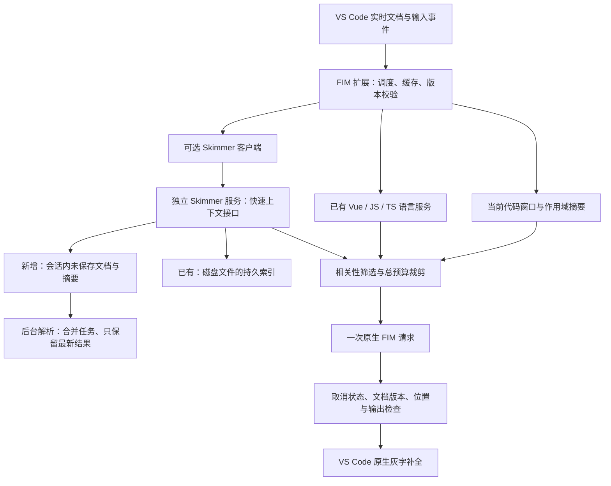

# 通用 FIM 代码补全扩展：自研方案评审稿

日期：2026-11-11  
修订：已复核并补充依赖新鲜度、灰字插入契约、文档同步协议、索引隔离、请求调度与前期验证门槛。  
状态：架构提案，尚未开始插件实现或性能实测。  
用途：供开发者评审需求边界、复用方式、实时编辑处理、实现成本和验收标准。

本文区分三种信息：用户已经明确的诉求、本地源码已经核实的资源、建议实施但尚未验证的设计。文中的性能预算均为建议目标，不能视为实测结果。

**推荐结论：自研一个通用的 VS Code FIM 行内补全扩展，直接连接 Frontend-Code-Skimmer 服务作为可选增强，复用现有 Vue/TypeScript 语言服务；按 Vue 2 → React Hooks → Vue 3 → Node.js 的顺序开发与验收。插件不复制 Skimmer 索引源码，基础补全不依赖 Skimmer。万行文件和未保存修改从第一阶段就进入设计与测试。**

## 一、用户的最终诉求

### 1. 产品定位

需要一个只负责代码行内补全的 VS Code 扩展：用户输入代码、停止一段时间后出现灰字，通过 VS Code 原生操作接受或取消。第一版允许从停止输入到显示建议花费约 2～3 秒，不把 300ms 级别的端到端响应作为前提。

扩展调用用户配置的模型服务，优先支持 DeepSeek Flash 的原生 FIM（Fill In the Middle）接口。用户填写 API Key、接口地址、模型名后即可开始使用。

第一版聚焦插入式 FIM 补全。聊天、Agent、终端执行、多文件自动修改、下一处编辑预测、替换整段已有代码均不属于第一版范围。

### 2. 框架范围与优先级

| 开发与验收顺序 | 范围 | 上下文适配重点 |
| --- | --- | --- |
| 1 | Vue 2 | Options API、props/data/computed/methods、模板表达式、组件注册、事件、mixins、Vuex、项目中的全局组件约定 |
| 2 | React Hooks | JS/TS、JSX/TSX、组件 props、state、回调、自定义 Hooks、Context、store 与相关类型 |
| 3 | Vue 3 | Options API、setup/script setup、响应式状态、defineProps/defineEmits、组件公开接口与模板绑定 |
| 4 | Node.js | JS/TS 模块、函数与类、异步调用、ESM/CommonJS、相关类型；包括 .mjs/.cjs/.mts/.cts 的验证 |

此顺序代表实施和验收优先级。运行时框架识别仍需依据项目与文件特征，不能为了“优先 Vue 2”就把 Vue 3 文件先交给 Vue 2 解析。

### 3. 必须适应的真实项目条件

- 项目较大，组件、工具模块、store、自定义 Hooks 等依赖较多。
- 某些单文件超过一万行，并且经常修改，属于日常工作场景。
- 对万行文件，第一版优先保证请求次数、输入 token 和费用可控；补全实时性可以放宽到停止输入后约 2～3 秒内完成。
- 不以拆分文件、缩小项目或强制保存后才补全作为前提。
- 能处理括号未闭合、表达式未完成、模板标签没写完等正常输入状态。
- 希望补全能够利用相关组件或模块的接口，而不是仅看光标附近文本。
- 不要求每次补全理解整个项目，但相关性不足或上下文不可用时应能降级。

### 4. “轻量”的实际含义

需要同时控制四类成本，不能只看安装包：

1. **扩展本体**：依赖少、激活工作少、没有复杂 Webview 和额外语言服务器。
2. **编辑时开销**：输入事件处理简短，不在每次按键时全文解析、全文 hash 或落库。
3. **后台开销**：索引和解析有频率、并发、队列与缓存上限。
4. **模型调用成本**：较长防抖、请求去重、取消、复用已有补全、限制输入输出，避免万行文件在连续编辑中反复付费请求。

“只有几十 KB”与“体验接近通义灵码”均不能在实现前承诺。验收要分别报告基础模式与启用 Skimmer 后的包体、CPU、内存、延迟和建议质量。

### 5. 配置与降级要求

- 基础配置：API Key、FIM 接口地址、模型名。
- 高级配置：防抖、自动触发最小间隔、输出上限、上下文预算、自动/手动触发、排除规则等，提供偏省钱的默认值。
- Skimmer 接入为可选项；没有安装、未索引、启动失败、版本不兼容、查询超时，都不应阻断基础补全。
- API Key 使用 VS Code SecretStorage 保存，普通配置和日志不包含 Key。
- 默认遵循项目忽略规则，避免无关文件和生成内容进入索引及提示词。

## 二、手头已有的资源与已知边界

### 1. Frontend-Code-Skimmer

Frontend-Code-Skimmer 已发布到 npm，正常使用不需要本地 checkout、手动构建或导入源码。标准 MCP 配置如下：

```json
{
  "mcpServers": {
    "frontend-code-skimmer": {
      "command": "npx",
      "args": [
        "-y",
        "@jokeran/frontend-code-skimmer@latest"
      ],
      "disabled": false
    }
  }
}
```

本地路径：`/Users/anshunli1/asl/code/github/frontend-code-skimmer`。本轮核对源码版本为 `4977ccbe5ac3c7e8aae25276bbf6b91f6df5df14`，package 版本为 `0.8.5`。本轮只读查看时，工作区没有显示已有改动。源码路径用于核对实现边界，普通用户和宿主通过 npm 包启动。

已经核实可以复用的基础：

| 现有能力 | 对补全的价值 | 使用边界 |
| --- | --- | --- |
| Vue 2 / Vue 3 / React 解析器 | 提取组件、方法、状态、事件等结构 | 需要验证未完成代码和真实项目约定，不能把正常文件解析能力等同于编辑态能力 |
| 通用 JS/TS 模块解析 | 提取函数、类、常量与依赖 | 当前主要接收 js/jsx/ts/tsx，Node.js 扩展名与 CJS 语义需补充验证 |
| SQLite 符号与关系索引 | 查询相关声明、组件关系、调用与数据关联 | 保存的是 AST 提取出的结构事实，不等于完整的类型检查器 |
| 静态组件目标定位 | 把模板组件与实际导入文件关联 | 动态注册、运行时工厂等不能按静态结果强行推断 |
| import/export 与部分再导出解析 | 减少只按同名符号搜索造成的误关联 | 部分能力依赖 precise 模式；第三方裸模块不应被假定为已完整索引 |
| 文件监听、文件级增量索引 | 保存后更新项目上下文 | 文件级增量更新仍可能整文件读取和解析，不等于 AST 节点级增量解析 |
| 内容指纹与新鲜度检查 | 识别磁盘索引是否落后 | 与编辑器未保存版本属于不同来源，需要分别标识 |
| 现有回归与语义流测试文件 | 可补充评估用例并复用验证方法 | 本轮未运行这些测试，不能声称当前版本已通过完整验证 |

需要正视的接口边界：

1. 已发布包仍以 MCP stdio 服务运行；支持 MCP 的宿主可以通过上方 `npx -y @jokeran/frontend-code-skimmer@latest` 配置启动。Codex、VS Code 扩展或其他宿主各自管理的 stdio 进程不能自动互相接管或共享。
2. 当前构建入口是 `src/index.ts`，会创建并启动 MCP 服务，尚未提供独立的核心库入口。不能把当前包主入口当作无副作用的解析库导入扩展。
3. 大部分现有查询经过读前同步守卫，等待配置为 3000ms，可能刷新脏文件；部分查询还会进一步重索引。适合分析任务，但不宜原样用作每次行内补全的查询路径。
4. 现有工具以分析输出为主，尚无专门面向补全、携带编辑器文档版本的快速结构化接口。
5. 当前文件监听读取磁盘文件，不能直接代表编辑器里尚未保存的代码。
6. Node.js 的完整模块格式、导出形态与项目场景需要专门验收，不能仅凭“支持 JS/TS”就宣布完成。
7. 当前 `SKIMMER_DB` 指定的是进程级固定数据库路径，不会按项目自动拆分；`files.path` 又以项目内相对路径作为唯一键。多根工作区不能让多个项目共用这一固定路径，插件专用缓存目录的按项目映射需要新增支持。

### 2. VS Code 现有能力

- 原生 InlineCompletionItemProvider：负责灰字和接受补全的编辑器交互。
- CancellationToken、文档版本、内容变更事件：用于取消、过期结果校验和增量同步。
- SecretStorage、原生设置与状态栏：无需自建复杂配置页面。
- 已安装的 JS/TS/Vue 语言服务：按需调用定义、Hover、补全、文档符号等能力。

语言服务是否能返回足够信息，取决于用户已安装扩展、项目配置、框架版本与提供器状态。插件不应为实现 FIM 再启动一套完整语言服务器。没有提供器时，仍使用当前文本窗口工作。

### 3. 模型服务

本轮调研核实的 DeepSeek 官方用法为 `POST https://api.deepseek.com/beta/completions`，使用 `prompt` 与 `suffix`，读取 `choices[0].text`；当前官方 Flash 模型名为 `deepseek-flash`。

插件保留可配置地址和模型名，避免绑定某一时间点的型号。第三方中转必须实际支持 FIM 的 prompt/suffix 语义与响应格式；仅支持 Chat Completions 不能视为兼容。

官方服务端上下文缓存可降低部分输入计算费用。本地缓存仍有独立价值：命中后可以省掉整个网络请求，尤其适合继续输入已经预测出的文本。

### 4. 可参考的开源实现

- **tabahead**：可参考模块划分、有限缓存、补全续显和局部编辑思路；本轮此前检查的版本缺少完善 Vue 适配，使用聊天接口，跨文件机制也有限，不作为推荐主底座。
- **FIM Autocomplete / Continue 的补全部分**：可参考原生 FIM 适配、上下文筛选、取消和结果过滤。是否支持当前项目的实际场景仍需测试，不整体搬入第一版。

Skimmer 已覆盖一部分最有价值的前端语义工作，因此没有必要先复制另一个通用补全工程，再维护两套前端解析与索引。

## 三、最终自研方案

### 1. 总体架构与复用决定

采用“薄扩展 + 可选 Skimmer 服务 + 既有语言服务”的架构。

下图描述建议架构，包含尚需新增的能力，并非现有实现图：



复用方式确定为：

| 方案 | 决策 | 理由 |
| --- | --- | --- |
| 通过服务接口连接 Skimmer | 第一版采用 | 索引和解析保持独立维护，扩展无需携带 SQLite 原生模块与整套解析依赖 |
| 抽出公共核心包供多端引用 | 暂不作为第一步 | 将来确有一体化安装、多个宿主共享解析库的需要时再拆，避免先做大规模重构 |
| 将 Skimmer 源码复制进扩展 | 不采用 | 会形成两份解析、索引和 bug 修复路径，增加升级和打包成本 |

“直接连接”仍需要开发快速查询与未保存文档能力；不代表现有工具接口已经完全满足实时补全。

### 2. 扩展内部职责

| 模块 | 职责 |
| --- | --- |
| CompletionProvider | 注册原生行内补全，区分自动和手动触发，检查选择区、补全菜单与插入范围，返回候选 |
| RequestScheduler | 统一调度自动/手动请求，控制防抖、实际在途请求、取消收尾、去重、超时与过期结果 |
| BufferTracker | 记录文档打开轮次、版本与变更，维护活动文档和依赖新鲜度记录；不在每次按键时解析全文 |
| ContextCollector | 并行收集附近文本、语言服务信息、Skimmer 摘要，并执行统一预算 |
| FrameworkAdapters | Vue 2、React Hooks、Vue 3、Node.js 的上下文选择与提示词组织规则 |
| SkimmerAdapter | 能力协商、长连接、批量文档同步、快速查询、失败降级 |
| FimProviderAdapter | 屏蔽接口地址、请求体与 SSE 响应差异；第一版先完整支持 DeepSeek 原生协议 |
| CompletionCache | 有限缓存、相同上下文复用、已输入前缀的剩余文本复用 |
| OutputFilter | 去除模型标记、处理重复后文和缩进，拒绝过期或明显无效结果 |
| ConfigAndStatus | Key、模型、开关、状态和本地诊断；不记录完整源码与 Key 的常规日志 |

框架适配器共用同一条请求链路。框架差异不应导致四套独立缓存、网络和灰字实现。

### 3. 一次补全的流程

1. 接到触发后，确认文件范围、语言、活动编辑器和光标；第一版只在单光标、空选择区且没有 `selectedCompletionInfo` 时提供插入式 FIM，其他情况返回空结果。
2. 记录当前 URI、文档打开轮次、文档版本、光标、选择区、模型配置与请求序号。
3. 优先尝试已有补全的剩余部分和本地缓存，验证前后文及来源依赖的新鲜度后直接返回。
4. 自动触发采用偏省钱的防抖，第一版建议默认 1000ms，可在 800～1500ms 范围内调节；手动触发跳过防抖。缓存命中不必额外等待同样时长。
5. 对自动触发增加同一文档的最小请求间隔和相同上下文的请求去重；用户只是继续输入已预测文本时优先续显，不重新请求模型。
6. 上下文查询优先使用已缓存摘要；语言服务和 Skimmer 尽力并行收集，默认额外等待上限为 500ms。手动触发或显式增强配置可试验 500～1000ms，但都受同一个收集截止时间约束，不能串行叠加多个完整超时。
7. 根据相关性裁剪上下文，将必需的本地代码与少量外部信息组织成 FIM 输入。
8. 自动和手动触发通过同一调度器发起一次模型请求；每个扩展实例最多有一个实际在途模型请求，取消收尾也占用该槽位。
9. 接收 SSE，收集有用候选；在原生补全 API 的返回边界内展示，不把“使用流式接口”误写成“必然逐 token 刷新灰字”。
10. 返回前再次校验取消状态、文档打开轮次、版本、光标、选择区、配置、来源依赖的新鲜度与请求序号；不匹配就丢弃。菜单选中项变化按第 8 节的 Provider 重入规则处理。
11. 过滤重复和模型格式标记，显式设置光标处的空插入范围，记录必要的缓存和不含源码的性能指标。

用户继续输入、移动光标、切换文档、改变相关配置时，立即使旧请求失效，并尽力中止网络请求。取消不应被解释为保证服务端不再计算或不计费。

第一版采用“成本优先”策略：自动补全宁可晚一些出现，也不在万行文件中为每个短暂停顿重复请求。建议默认规则为：停笔约 1000ms 才触发，同一文档两次自动模型请求的发送时间至少相隔 3000ms；上下文变化不会绕过这一间隔，相同上下文另做去重，已有预测文本优先续显。手动触发跳过防抖和自动请求间隔，仍受在途上限、超时和服务退避约束。这些数值均为待实测的试验默认值。

调度器只保留一个待执行意图：手动触发可替换待执行的自动触发，自动触发不能挤掉仍然有效的手动触发；文档或位置变化后，旧意图立即失效。相同输入的请求合并；需要替换实际在途请求时，先取消并等待本地传输结束，再发送最新有效意图，不能只递增请求序号就释放槽位。

模型 HTTP 总超时先以 8 秒作为试验上限，从发送时开始计时，首包等待和流读取均计入该上限。超时或取消时关闭本扩展持有的请求及流，收尾完成后才释放槽位；传输未能收尾时暂停新请求并重建本扩展的传输资源，避免堆积旧连接。该本地并发约束不能保证已取消的服务端任务立即停止计算或计费。

稳定网络下、未命中限频或退避时，整体体验目标仍是从停止输入到显示建议约 2～3 秒。A 阶段先测基础链路，B 阶段再测增强链路；分开记录约 1000ms 防抖、最多 500ms 的默认额外上下文等待、模型生成与最终显示耗时。已经完成的上下文可提前复用，不能为每次按键启动一次预取。若剩余时间不足，优先跳过额外上下文；限频、退避和取消导致未展示的次数另行统计，不从体验报告中静默排除。8 秒网络上限是故障边界，不能用来证明达到 2～3 秒体验目标。

### 4. 万行文件的实时编辑方案

#### 4.1 三种数据状态

| 状态 | 数据归属 | 用途 |
| --- | --- | --- |
| 编辑器当前文档 | VS Code | 当前文件 prefix/suffix、实时位置与未保存修改的权威来源 |
| 会话内文档镜像与摘要 | 新增内存层 | 保存尚未落盘的内容、局部结构和最新成功摘要，关闭文档后释放 |
| 磁盘持久索引 | Skimmer / SQLite | 已保存文件的符号、关系、组件绑定与跨文件检索 |

当前文件和已打开的未保存依赖，优先使用对应编辑器会话的内容。SQLite 不能覆盖更新的未保存内容。

BufferTracker 还维护项目内所有已打开文档的轻量新鲜度记录，只记录 URI、打开轮次、版本和状态，不要求同步这些文档的全文。未保存文件进入 `dirty` 状态；保存、关闭时放弃修改或其他回到磁盘内容的操作后，进入 `pendingIndexConfirmation` 状态。在确认索引指纹与当前磁盘内容一致之前，两种状态都屏蔽该文件的磁盘接口、源码片段及由旧接口产生的关联信息。首次激活和重连时也要重建这些记录，不能只监听之后发生的输入。

新鲜度确认在后台对照当前磁盘内容与索引指纹，不放到逐键处理或快速查询路径中。确认期间再次编辑、保存或重新打开文档时，旧确认失效；只有对应状态仍然有效且文件已不再 dirty 时才解除屏蔽，不能用旧确认清掉新的未保存状态。

例如修改 `Child.vue` 的 props 后不保存，切回父组件补全：只同步父组件内容，但查询必须携带对子组件旧索引的屏蔽信息。子组件保存后，在索引确认追上磁盘之前仍保持屏蔽；有实时语言服务结果就使用，否则省略该接口。关闭文档或切换活动文档只释放内容镜像，不得顺带提前清除尚未确认的新鲜度记录。

#### 4.2 输入事件只做轻量工作

- 记录版本和 VS Code 提供的内容变更范围。
- 标记受影响的摘要和补全结果失效。
- 合并待同步变更，不在每次按键时复制全文、全文 hash、全文解析或写 SQLite。
- 变更批次按对应文档版本应用；多光标、批量替换、撤销/重做必须有专门一致性测试。

只允许合并传输批次，不能直接丢弃仍被后续增量依赖的中间补丁；可丢弃的是尚未运行的解析任务。增量链缺失或无法正确合并时，改发最新全文快照，不能把最终版本号配给不完整的变更列表。

文档首次打开、重连或版本失配时允许传输一次全文快照。之后优先批量传增量修改；文档镜像需要完整字符串时，尽量在批次处理阶段生成，避免逐键反复拼接完整大字符串。

#### 4.3 后台解析与队列

- CPU 密集解析放入后台 worker 或子进程，避免在 VS Code 扩展线程执行。
- MCP 接收、取消与快速查询尽量不被长时间同步解析阻塞；现有索引路径的同步解析也是后续需要评审的改造点。
- 每个活动文档最多一个运行中的解析任务和一个待处理的最新版本；中间版本合并或丢弃。
- 已运行的同步解析不一定能立即取消，可以让它结束后丢弃过期结果，不能为了每次修改反复创建进程。
- 优先处理活动文档；其他文档只在确有上下文需要时更新。
- 解析结束后保留紧凑摘要，默认不长期缓存所有文档的完整 AST。
- 解析任务和缓存有总量上限，关闭文档、退出工作区、连接断开后清理。

第一版允许后台整文件解析，但必须合并任务并测量耗时。只有在真实大文件上证明仍然成为瓶颈，才进一步引入 SFC 分块或 AST 节点级增量解析；不能把这些尚未实现的优化当作已有性能保证。

#### 4.4 不完整语法与旧摘要

输入中的语法不完整属于正常状态。解析失败时继续使用当前文本窗口，必要时保留上次有效摘要。

旧摘要不能直接提供未经校验的新版本行号。能确认未受变更影响的结构可继续作为上下文；无法确认的相关声明、定位和接口应跳过，或由语言服务重新获取。

补全展示不能以“整个一万行文件可以编译”为前提。

#### 4.5 输出给模型的内容

“光标前 300 行 + 后 100 行”只作为可调上限，不是固定发送量。还必须有总字符/token 预算和语义裁剪。

收集顺序建议为：

1. 光标附近必要的实时代码，尤其光标所在行和相邻后文。
2. 当前函数或组件的相关参数、状态、作用域与声明摘要。
3. 当前实际引用的组件、Hook、store 或模块的接口。
4. 与当前位置高度相关的少量实现片段。

预算紧张时先删除低相关的外部片段和历史信息，不能把真正的光标边界裁错。长单行也必须受字符预算限制。

第一版以成本优先：可先以总输入约 2K～4K tokens、输出 64～128 tokens 作为默认试验区间；只有手动触发或上下文明确不足时，才允许提高到约 8K 输入或更高输出上限。最终默认值依据质量、延迟与费用对比确定。

### 5. Skimmer 的新增接入能力

以下接口名称和字段均为建议，当前仓库尚未实现。

#### 5.1 编辑态文档同步

建议提供 `skimmer_update_document`，支持打开、变更、关闭以及版本失配后的完整重同步。以下版本确认和补丁规则属于该新增接口的协议要求，不代表现有 Skimmer 已支持。

关键入参：

- client/session ID、规范化 project root、URI、语言或框架信息。
- `documentInstanceId`：每次编辑器重新打开同一 URI，或已释放镜像后重新建立同步时产生的新标识；连接重建时使用新的 session ID。这样切换回同一文件时，旧关闭消息也不能清除新镜像。
- `baseVersion`、`documentVersion`。
- 初次同步的完整文本，或保留各自版本边界的内容变更批次。

文档镜像按“客户端会话 + 项目 + URI + documentInstanceId”隔离。文档版本只在同一个打开轮次内比较，不同窗口或重新打开后的版本不能互相比较，也不能把 A 窗口未保存的内容直接提供给 B 窗口。

协议至少明确以下规则：

1. 偏移与长度以 UTF-16 code unit 计量，与 VS Code 文本位置一致；传输和应用时保留原始换行，不擅自把 CRLF 转为 LF。
2. 一个编辑事件内的增量必须基于同一修改前版本，由客户端校验为互不重叠的替换后，按 `rangeOffset` 从大到小应用。存在重叠、相同插入偏移或无法确定坐标基线时，回退到最新全文快照；不同编辑事件必须保留原有先后和各自的 `baseVersion`。
3. 增量批次只有在打开轮次匹配、已接受版本等于 `baseVersion` 且偏移有效时才原子应用；不要求版本号恰好加一，但新版本必须递增。失败返回 `resyncRequired`，不得部分应用后继续使用镜像。全文重同步允许覆盖同一打开轮次的相同版本，拒绝版本倒退，并使旧解析任务及摘要失效；首次打开或新会话以全文快照建立版本基线。
4. 响应分别给出 `acceptedVersion` 和 `parsedVersion`：前者确认文本已接收，后者代表可用摘要的来源版本。接收成功不代表解析完成；旧摘要的使用仍遵循第 4.4 节规则。
5. 同一文档的更新按版本串行确认，等待 ACK 时只合并待发批次。ACK 丢失、版本失配或重连后用全文快照重建，不盲目重复应用增量；旧打开轮次的解析结果和关闭消息不得影响新镜像。

第一阶段仅对当前活动文档同步完整文本与增量。其他未保存依赖使用语言服务，或屏蔽其旧索引信息；这些依赖的新鲜度元数据仍需维护。后台新鲜度确认可以在补全之外执行，快速查询不得为了清除屏蔽记录强制等待重建。有明确质量收益后再扩展少量关联文档，避免一次同步所有打开文件。

#### 5.2 快速上下文查询

建议提供 `skimmer_get_completion_context`，供插件确定性调用，不经过模型选择工具。

入参包括：会话、项目、文件、文档打开轮次与版本、光标位置、附近标识符/组件名、该会话的 `dirty` / `pendingIndexConfirmation` 文件屏蔽快照，以及结果数量和字符预算。屏蔽规则同时作用于直接结果和由被屏蔽文件旧内容派生的关联，不能只删除最终源码片段。

输出为结构化数据：

- 相关的符号、组件接口和有限源码片段。
- 每项来源文件、来源类型（buffer/index/language service）、位置和版本或内容指纹；由其他文件关系派生的结果还要列出必要来源依赖。
- 静态绑定已确认或仅启发式推断的标记。
- overlay/index 是否就绪、是否陈旧、是否截断、耗时信息，以及活动文档的 `acceptedVersion` / `parsedVersion`。

查询只消费已完成的摘要或索引快照，不因一次补全强制等待重建，不默认启动全仓库搜索、影响分析或多层数据流追踪。

服务端先按屏蔽快照筛选，扩展收到结果后再按最新记录过滤一次，防止查询期间依赖刚被修改。组装模型输入、缓存命中和返回灰字时，都要核对实际使用的来源依赖；请求期间相关依赖变化后，旧结果不得继续展示。

现有分析工具的读前同步语义可以继续服务分析场景；新接口使用独立路径，不能简单删除原守卫来换取速度。

#### 5.3 忙碌、取消与背压

- 扩展侧拥有独立的查询等待期限；默认额外等待不超过 500ms，手动触发或显式增强配置可试验 500～1000ms，到期立即走已有上下文，不依赖服务端恰好能执行定时器。语言服务和 Skimmer 共用截止时间。
- 客户端取消通知需要服务端处理器配合；同步 CPU 任务无法靠 AbortSignal 自动变成可中断任务。
- 仅使用 Promise.race 会结束等待，不会自动停止后台任务，因此服务端还需限制在途查询、合并相同查询并丢弃过期请求。
- 服务端更新期间可以快速返回 busy/not-ready，而不是无限排队。
- Skimmer 故障后短暂暂停重复连接尝试，在状态栏说明降级；不在每次按键时弹错或重启服务。

#### 5.4 进程与持久索引管理

第一版确定采用“每个 VS Code 窗口一个长期 stdio 服务进程，窗口会话与项目分别隔离数据库”的方式。该进程按需管理多个项目，不在每次补全或每次切换文件时启动新进程。默认启动命令沿用已发布 npm 包的方式：`npx -y @jokeran/frontend-code-skimmer@latest`；运行前需要满足 Skimmer 当前 Node.js >=22 与原生依赖要求。

上方 JSON 是 MCP 宿主的标准配置；它只说明宿主如何启动服务，不等于 FIM 扩展可以直接读取另一个宿主的 MCP 配置或复用其 stdio 进程。FIM 扩展需要自己实现 MCP 客户端并按等价命令启动/管理子进程，或提供明确的外部服务连接配置。没有得到宿主配置访问权时，扩展应按自己的配置启动 npm 包，不能假定 Codex 已经启动的服务存在。

扩展为本窗口会话分配专用缓存根目录，例如 `<globalStorageUri>/skimmer/<windowSessionId>/`；服务端按规范化真实项目根路径的哈希分配其下数据库。窗口会话 ID 和项目 ID 都必须参与隔离，不能只依赖项目名。每个数据库只由所属服务进程负责写入和迁移，解析 worker 只返回结果，由所属进程统一落库。

这需要为 Skimmer 新增可配置的缓存根目录及按项目映射能力，例如建议参数 `SKIMMER_CACHE_DIR`，当前尚未实现。多根工作区使用这一目录映射，不设置进程级固定 `SKIMMER_DB`；两者同时配置应明确报错，不能静默覆盖。扩展启动服务时显式传入自己的项目与缓存配置，避免意外沿用其他宿主的固定数据库路径。

`@latest` 适合普通安装和快速试用，但它会随 npm 发布移动。开发验收、问题复现和兼容性报告必须记录实际解析到的包版本；需要可重复构建时，将命令中的 `@latest` 固定为已验收版本，例如 `@0.8.5`，升级后重新跑协议、索引隔离和性能回归。扩展的默认配置可以继续使用 `@latest`，但启动日志和诊断信息要展示实际版本。

VS Code 的不同窗口与 Codex 各自启动服务时，分别使用自己的数据库，不共享 buffer、队列或 watcher。这一选择接受重复索引的磁盘与 CPU 成本，需在 B 阶段测量，并设置项目数、空闲回收和失效会话缓存的容量/保留期限；清理不得影响仍在使用的会话。扩展退出时只关闭自己启动的服务和 worker。

若重复索引成本在真实项目中不可接受，再评估本地共享入口、实例发现和单一写入管理；不能直接把不同进程指向同一 SQLite 文件来替代共享服务。

扩展不直接依赖内部数据库表结构，不通过导入当前 MCP 主入口来获取数据库对象。

### 6. 多框架上下文的收集边界

**Vue 2 优先阶段：**先保证真实父子组件 props/事件、当前组件 methods/data/computed 和静态依赖的补全。mixins、Vuex、全局注册分别设置用例；动态运行时逻辑解析不到时，减少猜测并降级。

**React Hooks 阶段：**优先组件接口、函数作用域、自定义 Hook 的入参与返回接口、handler/state/store 关联。不能只因“组件名相同”就选取其他文件；调用点、导入目标和作用域需要参与筛选。

**Vue 3 阶段：**补齐 script setup、普通 setup、Options API 的差异，检查模板到脚本位置映射和 props/emits/expose 信息。已有 Vue 3 解析不能替代编辑态与语言服务验证。

**Node.js 阶段：**验证 ESM/CJS、扩展名、路径别名、导出与再导出，以及第三方类型。第三方库类型优先复用语言服务，避免为补全索引所有 node_modules。Express 等具体框架深度语义不作为“基础 Node.js 支持”的先决条件，若需要另列增强范围。

### 7. 缓存与版本一致性

缓存分层，但每层都需要条数、字节数和生命周期限制：

| 缓存 | 内容 | 失效条件 |
| --- | --- | --- |
| 补全结果 | 有限前后文、来源依赖与预测文本 | 上下文、来源依赖新鲜度、模型、接口或生成参数变化；TTL 到期 |
| 剩余补全 | 用户已经输入一部分后的剩余文本 | 输入偏离预测、后文或位置条件不成立 |
| 上下文摘要 | 组件/符号接口、少量关联片段 | 对应 buffer 版本或索引文件指纹改变 |
| 项目持久索引 | 磁盘文件的结构与关系 | Skimmer 的文件变更与重建机制 |

建议补全结果先采用最多 64～128 条、总计约 1～2MB、短 TTL 的试验配置；大条目提前截断或拒绝缓存。摘要缓存单独设总量上限，不能仅限制条数。另按第 3 节设置同一文档的自动触发最小间隔，避免上下文略有变化就绕过去重而反复调用模型；手动触发只豁免自动防抖和间隔。

缓存键及命中校验应区分项目/会话、文档打开轮次、来源文件、模型与接口、相关前后文、生成参数及实际使用的外部上下文版本。来源依赖变为 dirty、等待索引确认或版本发生变化时，关联摘要和补全结果立即失效，不能只等 TTL。避免逐键计算整个大文件 hash。

文档版本用于结果有效性判断，但不能只把“版本不同”作为全部缓存逻辑，否则无法复用已预测文本的剩余部分。续显需要验证实际输入与原预测一致，并检查剩余后文条件。

### 8. 提示词与输出处理

原生 FIM 的 prompt/suffix 保留真实光标边界。额外的组件接口和相关片段由框架适配器以可区分的上下文形式组织，避免模型把外部片段误当成当前文件待续写正文。

Vue 模板、SFC、JSX 与普通 JS/TS 的注释和结构不同，需要分别验证提示词格式。不能把一段统一注释模板无条件应用到所有位置。

优先过滤模型控制标记、重复的后文、无意义空结果与明显的解释性输出。缩进和边界处理必须保留用户已有代码，不能通过广泛 trim 或简单删括号破坏语义。

第一版使用 VS Code 原生灰字交互，不额外接管整个 Tab/Escape 行为；避免破坏普通缩进、代码片段和已有补全菜单的操作。

返回 `InlineCompletionItem` 时必须显式使用 `new Range(position, position)`，`insertText` 只包含待插入文本，不能省略 `range` 而触发当前位置单词范围的默认替换。候选可以跨行，插入范围仍为空范围；模型输出与已有后文重叠时只处理能确认的重叠，无法确认则拒绝候选，不删除用户已有后文。

官方 API 要求：存在 `selectedCompletionInfo` 时，行内候选必须使用与菜单选中项相同的范围，并延伸该项文本。第一版对携带该字段的请求统一返回空结果。菜单选中项变化时 VS Code 会重新调用 Provider，扩展在每次调用入口更新请求序号，使旧请求失效，并在返回前检查取消令牌和序号；不读取编辑器内部菜单状态。后续如需兼容，再实现对应范围和文本契约。多光标或非空选择区同样暂不提供 FIM。此降级只影响本扩展的候选，不接管编辑器原有补全。

### 9. 无 Skimmer 时的行为

| 情况 | 处理 |
| --- | --- |
| 未配置或未安装 | 当前代码窗口 + 现有语言服务，正常 FIM |
| 服务启动中、项目尚未索引 | 先使用基础模式，准备完成后在后续请求增强 |
| 上下文查询超时或 busy | 本次跳过 Skimmer，不串行追加长时间等待 |
| 当前文件未保存 | 使用实时 buffer；没有编辑态摘要时用窗口和语言服务 |
| 依赖文件未保存，或保存后索引尚未确认追上 | 按会话新鲜度记录屏蔽旧接口；优先实时来源，无法获取则省略 |
| 框架暂未深度适配 | 保留通用文本与语言服务补全能力，状态可识别 |
| Key/额度/限流问题 | 适当退避并显示一次清晰状态，避免逐键重试 |

基础模式与增强模式使用同一模型配置和接受操作，用户不必切换两套产品流程。

### 10. 开发顺序与交付门槛

| 阶段 | 主要交付 | 进入下一阶段前要证明什么 |
| --- | --- | --- |
| A：通用内核 + Vue 2 基线 | 原生 FIM、SecretStorage、统一请求调度、有限缓存、原生灰字、依赖新鲜度跟踪、万行文件基本补全、首批兼容性与基础延迟测量 | 未保存代码可补、没有过期结果覆盖、Skimmer 不可用仍可使用；实际请求受限；插入范围正确；携带菜单选中项、多光标和非空选择区时按约定降级 |
| B：Vue 2 增强 + Skimmer 适配 | 快速上下文接口、带 ACK 的编辑态镜像与摘要、依赖屏蔽、窗口/项目隔离数据库、静态父子组件和当前作用域上下文 | 未打开子组件也能取到接口；未保存及保存后等待索引时不读旧接口；增量与重连一致；多窗口/多项目不串库；后台忙碌不阻断补全；增强等待与重复索引成本有实测 |
| C：React Hooks | JSX/TSX、自定义 Hook、props/state/handler 与 Context/store 的相关上下文 | 在相同内核上通过对应跨文件和大文件用例 |
| D：Vue 3 | script setup/setup/Options API 和模板上下文 | SFC 位置、未保存接口变化与降级正确 |
| E：Node.js | ESM/CJS、扩展名、模块接口与语言服务集成 | 模块格式用例通过，未误宣布动态导出全部可解析 |
| F：性能与发布收敛 | 构建体积、完整兼容性矩阵、资源与真实使用数据 | 达到约定环境的验收目标，安装流程可复现 |

每一阶段都复用公共内核，并在新增能力后回归已完成框架。万行文件测试从 A 开始，不能到 F 才发现架构不适合。

A 阶段即确定并记录 `engines.vscode` 最低版本、实际测试的 VS Code 版本与操作系统、Vue 2 语言服务扩展及版本、项目 Vue/TypeScript 版本。验证语言服务存在、缺失和未就绪三种情况；能注册 Provider 不等于能稳定显示和接受灰字。最低版本应依据实现实际使用的稳定 API 与运行验证确定，不能仅凭 InlineCompletionItemProvider 的引入版本宣称兼容。

### 11. 评审与验收标准

#### 11.1 不依赖模型随机性的正确性要求

- 已取消或文档/位置失效的结果不得激活为当前补全。
- 单个文档解析队列不会随连续输入无限增长。
- Skimmer 断开、索引忙碌和查询超时时，基础补全仍可触发。
- 未保存文档不被旧磁盘索引覆盖；不同会话的 buffer 隔离。
- 依赖保存、放弃修改或关闭后，索引未确认追上前仍不能复用旧接口；查询和模型请求期间依赖变化也会使对应结果失效。
- 增量批次完整应用或完整拒绝；`acceptedVersion` 与 `parsedVersion` 可分别验证，旧打开轮次的消息不能修改新镜像。
- 自动与手动请求共用一个实际在途槽和一个待执行意图；取消收尾不提前释放槽位，自动限频不能被上下文变化绕过。
- 同一窗口的不同项目即使存在相同相对文件路径，也不共用数据库；不同窗口和 Codex 不写入同一数据库。
- 多次打开/关闭文档和切换项目后，没有无限增长的缓存、解析任务或重复服务进程。
- 模型配置和相关依赖变化后，不继续复用错误缓存。
- 原生 Tab、代码片段、缩进、撤销行为不被破坏。
- 插入式候选不替换已有单词或后文；请求携带菜单选中项、多光标和非空选择区时按约定降级，菜单选中项变化后的旧请求不展示。

以上一致性要求使用可控制返回顺序的模型/Skimmer 测试替身验证；真实模型只承担协议连通性、质量与耗时测量，不能用随机生成结果代替确定性断言。

#### 11.2 大文件必测场景

使用用户真实万行文件，并记录字节数、模板/脚本分布和依赖规模；合成样本只能补充压力测试。

1. 光标位于文件开头、中间、8000 行之后和结尾。
2. 连续输入、跨行编辑、快速删除、粘贴、多光标修改、撤销/重做。
3. 未闭合表达式、JSX、模板标签与临时语法错误。
4. 新增未保存 import、方法、状态、props 或事件。
5. 子组件未手工打开，但已存在于项目索引。
6. 子组件或 Hook 接口未保存修改后，调用方请求补全。
7. 保存/自动保存与索引重建并发发生。
8. 长单行、包含大量方法的组件、超长单函数。
9. 切换文件和项目时，旧网络结果与旧解析结果同时返回。
10. Skimmer 不存在、失联、版本不兼容、索引落后和解析失败。
11. 子组件修改后切回调用方，分别测试未保存、自动保存后索引未追上、保存失败，以及关闭时放弃修改。
12. 同一事件多处修改、emoji 等非 BMP 字符、CRLF 换行、连续跨版本批次、ACK 丢失和连接重建。
13. 同一 URI 关闭后重新打开，旧解析结果、旧 ACK 和旧关闭消息延迟返回。
14. 两个项目都包含 `src/App.vue`；多根工作区、同项目多窗口与 Codex 同时启动，检查数据库路径和服务生命周期。
15. 自动请求期间手动触发、连续手动触发、取消后旧连接延迟结束、HTTP 超时及流中断。
16. 单词中间、行尾、自动配对括号内显示与接受建议；补全菜单选中项变化、多光标和非空选择区的降级。

#### 11.3 性能目标与测量方式

下表是建议评审目标，均未实测，应在约定机器、VS Code 版本和真实项目上定稿。

| 指标 | 建议目标/记录要求 |
| --- | --- |
| 输入变更处理 | 扩展自身单次处理 p95 不超过约 5ms；不等于整个编辑器输入延迟 |
| 本地缓存命中 | 记录纯查询耗时及触发到显示耗时，目标是不再发模型请求 |
| 额外上下文等待 | 默认上限 500ms；手动或显式增强配置可试验 500～1000ms。按公共截止时间到期降级，不叠加多个串行预算；A/B 阶段分别测量 |
| 端到端补全体验 | 记录停笔、防抖、上下文、首 token、可展示候选、最终显示的 p50/p95；第一版目标是在稳定网络下约 2～3 秒内完成，不以 300ms 为目标 |
| 请求节省效果 | 记录自动/手动触发、缓存/续显、去重/限频/退避、实际模型请求、取消/超时及未展示次数；记录可获取的实际 tokens，取消后未收到 usage 的成本标为未知，估算值单列 |
| 队列与并发 | 运行中解析任务和待处理任务有明确上限；分别记录有效结果任务数、HTTP 实际在途数及取消收尾耗时，持续输入期间不积压历史版本 |
| 内存 | 持续编辑和反复切换文档后趋于稳定；分别统计扩展进程与 Skimmer/worker |
| CPU | 分别统计空闲、输入、后台解析、保存重建，检查扩展线程上的同步长任务 |
| 体积 | 报告扩展 VSIX、主要 JS bundle、可选后端依赖体积；不预设“几十 KB”已实现 |

资源对比至少包含三组：仅原有语言服务、增加基础 FIM 插件、再开启 Skimmer 增强。避免把已有语言服务器成本全部计入新插件，也避免漏掉新增子进程成本；增强模式还需记录单窗口与多窗口隔离索引的启动、磁盘和 CPU 成本。

建议质量用固定编辑点比较“无额外上下文 / 语言服务 / 语言服务 + Skimmer”，统一模型、参数和输入，记录接口正确率、可用率及典型失败，不仅展示成功案例。不能用单次生成或接受率一个指标证明接近商业产品。

### 12. 需要评审者明确给出意见的事项

1. 薄插件加可选服务的边界是否合理；当前阶段是否有充分理由抽公共包。
2. Skimmer 新增编辑态文档与快速查询接口的成本，是否优于插件内另建前端解析器。
3. 现有同步解析和 SQLite 查询是否会长时间占用 MCP 服务线程，哪些操作需要 worker/子进程隔离。
4. 第一版窗口/项目隔离索引的重复成本是否可接受，新增缓存根目录映射与会话清理是否满足交付门槛。
5. 文档打开轮次、增量 ACK、旧摘要、依赖屏蔽及保存后索引确认的规则是否覆盖真实编辑场景。
6. 首个 Vue 2 版本应该包含哪些 mixins/Vuex/全局组件能力，哪些明确降级。
7. React Hooks、Vue 3、Node.js 各自的“支持完成”定义与用例是否可验收。
8. 提示词预算、上下文等待、后台任务和缓存上限是否适合用户真实文件。
9. 是否存在更小成本的现成扩展，已经能在同样样本、同样模型上通过这些验收项。

### 13. 本次交付与验证边界

本次交付为需求和架构评审稿，未实现扩展或上述新增 Skimmer 接口，未运行模型请求、索引重建、性能基准或插件兼容性测试。已有测试文件的存在不代表本轮运行通过。

本次复核重新确认了上述 Skimmer 版本及固定数据库路径、文件唯一键的源码边界，并依据 VS Code 官方 API 核对了 `range` 默认行为、`selectedCompletionInfo` 与文档变更事件字段。新增的同步协议、缓存目录参数、请求上限和时间预算仍是待实现、待运行验收的设计约定。

本轮补充确认：Frontend-Code-Skimmer 已发布 npm，普通 MCP 宿主可按标准 `npx` 配置启动；该配置不改变多宿主进程隔离、数据库隔离和版本记录要求。

源码依据：

- [Skimmer 包配置与依赖](/Users/anshunli1/asl/code/github/frontend-code-skimmer/package.json:1)
- [当前 MCP 构建入口](/Users/anshunli1/asl/code/github/frontend-code-skimmer/tsup.config.ts:4)
- [MCP 创建及工具注册](/Users/anshunli1/asl/code/github/frontend-code-skimmer/src/index.ts:24)
- [读前同步守卫](/Users/anshunli1/asl/code/github/frontend-code-skimmer/src/tools/read-guard.ts:67)
- [静态组件目标定位](/Users/anshunli1/asl/code/github/frontend-code-skimmer/src/parser/component-binding.ts:19)
- [符号结构](/Users/anshunli1/asl/code/github/frontend-code-skimmer/src/types.ts:51)
- [解析器选择](/Users/anshunli1/asl/code/github/frontend-code-skimmer/src/parser/index.ts:38)
- [通用 JS/TS 解析器](/Users/anshunli1/asl/code/github/frontend-code-skimmer/src/parser/tooling-ts-parser.ts:21)
- [文件内容读取与更新](/Users/anshunli1/asl/code/github/frontend-code-skimmer/src/indexer/indexer.ts:703)
- [模块路径解析边界](/Users/anshunli1/asl/code/github/frontend-code-skimmer/src/parser/import-graph.ts:301)
- [固定数据库路径与项目路径映射](/Users/anshunli1/asl/code/github/frontend-code-skimmer/src/indexer/project-manager.ts:244)
- [数据库文件相对路径唯一键](/Users/anshunli1/asl/code/github/frontend-code-skimmer/src/storage/database.ts:68)

公开接口参考：

- [VS Code 行内补全 API](https://code.visualstudio.com/api/language-extensions/programmatic-language-features#show-inline-completions)
- [VS Code InlineCompletionItem 范围与插入文本](https://code.visualstudio.com/api/references/vscode-api#InlineCompletionItem)
- [VS Code InlineCompletionContext 与菜单选中项](https://code.visualstudio.com/api/references/vscode-api#InlineCompletionContext)
- [VS Code 文档变更事件](https://code.visualstudio.com/api/references/vscode-api#TextDocumentContentChangeEvent)
- [VS Code 语言服务命令](https://code.visualstudio.com/api/references/commands)
- [VS Code SecretStorage](https://code.visualstudio.com/api/references/vscode-api#SecretStorage)
- [DeepSeek FIM](https://api-docs.deepseek.com/guides/fim_completion)
- [MCP TypeScript SDK v1.29.0 客户端与 stdio](https://github.com/modelcontextprotocol/typescript-sdk/blob/v1.29.0/docs/client.md)

本地源码链接便于当前电脑定位。交给其他评审者时，应同时提供 Skimmer 对应版本的源码；本文的事实摘要与设计边界可以独立阅读。
